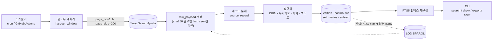

# Plan A: 경량 개인/로컬 DB (Seoji 날짜 윈도우 → SQLite 단일 파일)

> 작성일: 2026-10-22. 사실 관계는 모두 `research_notes/한국 서지정보 API 조사/`의 노트를 근거로 한다. 노트에 근거가 없는 수치(호출 속도, 기간, 비용)는 **설계 선택** 또는 **추정**이라고 표시했다.

## 1. 목표와 범위

**목표**: 혼자 쓰는 한국 도서 DB를 만든다. 국립중앙도서관 ISBN 서지정보유통지원시스템(Seoji) API를 날짜 윈도우로 수집하고, SQLite 파일 하나에 담는다. 검색·조회·내보내기는 CLI로 한다. 매일 cron이나 GitHub Actions가 자동으로 갱신한다.

**포함 범위**
- Seoji에 등록된 ISBN 도서. 종이책은 기본으로 넣고, 전자책은 옵션(`ebook_yn`)으로 고른다.
- 최근 N년 백필(기본 10년, 설정 가능)과 근간(발행예정일이 앞으로 90일 안인 책).
- 매일 증분 갱신. 예정일·가격 변경과 납본 여부 변화를 반영한다.
- (선택) 개인 서재 테이블(`my_shelf`): 읽음/읽는 중/위시 상태와 메모.
- (선택) ISBN 단건 보강: 국가서지 LOD SPARQL에서 KDC, 형태사항, 주제명을 가져온다.

**제외**: 전체 국가서지 400만 건 적재(→ Plan B), 대출 통계(→ Plan D), 공개 웹 서비스(→ Plan C), 표지 이미지 복제, 상업 API.

**완료 기준**
- `seoji sync`가 매일 실패 없이 돌고, 실패하면 알림이 온다.
- ISBN·제목·저자·출판사 검색이 로컬에서 즉시 응답한다.
- DB 파일 하나만 복사하면 백업이 끝난다.
- 원본 응답(raw)에서 정규화 테이블을 언제든 다시 만들 수 있다.

## 2. 사용할 API와 이유

| API | 용도 | 고른 이유 (근거) |
|---|---|---|
| **Seoji** `https://www.nl.go.kr/seoji/SearchApi.do` | 주 수집원 | NLK API 중 **날짜 범위 필터가 문서화된 유일한 API**다(`start_publish_date`/`end_publish_date`, 발행예정일 기준). 부가기호(EA_ADD_CODE), SET_ISBN, KDC, 가격(PRE_PRICE/REAL_PRICE), 표지 URL, INPUT_DATE/UPDATE_DATE 등 약 40개 필드를 준다. `page_size=200`이 실제로 동작한다는 사례가 있다. (nlk_apis.md Q1-1, Q2) |
| **국가서지 LOD SPARQL** `https://lod.nl.go.kr/sparql` (선택) | ISBN 단건 보강 | 키가 필요 없다. 라이선스는 공공누리 1유형 + CC0이다. Seoji에서 비어 있는 경우가 많은 쪽수·크기 대신 `bibframe:extent`("263 p", "20 cm")를 받고, KSH 주제명과 `nlon:kdc`도 받는다. (nlk_apis.md Q1-8, Q3) |

### 사용하지 않는 API와 이유

| API | 제외 이유 |
|---|---|
| LOD 전체 덤프 | 일반도서 TTL만 1,057.9 MB다. 이걸 스트리밍으로 변환하고 병합하는 일은 경량 범위를 넘는다. → Plan B |
| data.go.kr `BookInformationService_v2` | 날짜 필터가 없고 개발계정 트래픽이 10,000이다. 내용도 LOD와 겹친다. (nlk_apis.md Q1-7) |
| 소장자료 `search.do`, KOLIS-NET, 국가서지 `seojiSearch.do` | 결과를 500건까지만 넘겨 볼 수 있다(DATA LIMIT 500). 쪽수·가격 필드도 없다. 수집용이 아니라 탐색용 API다. |
| CIP `cip.do` | 메뉴에서 빠졌다. Seoji의 `deposit_yn=N`이 이를 대체한 것으로 보인다. |
| 도서관 정보나루 | 대출 통계는 이 계획의 범위 밖이다. IP를 등록하지 않으면 하루 약 500건밖에 못 쓴다. 약관상 사전 승낙 없이 복제하는 것도 제한된다. (other_public_apis.md A) |
| Kakao 책 검색 | 운영정책상 캐시는 UX 개선 목적으로만, 최신 상태를 유지하는 조건에서 허용된다. DB에 복제하려면 사전 승낙이 필요하다. (commercial_apis.md Q2) |
| Naver 책 검색 / 알라딘 | Naver는 2026-07-31에 종료됐다. 알라딘은 2026-10-30에 종료된다. 알라딘 약관은 저장(캐시 포함)을 금지하므로 **종료 전에 몰아서 긁어 두는 것도 하지 않는다.** |
| KPIPA, RISS, 국회도서관 | 각각 위원회 심사, 기관 대상 BY-NC-ND, 논문 중심 데이터다. 개인용 경량 범위에 맞지 않는다. |

## 3. 데이터 흐름



## 4. 저장소 선택과 스키마

**SQLite를 쓴다.** 파일 하나로 끝나고, Python 표준 라이브러리에 들어 있으며, UPSERT와 FTS5를 지원한다. DuckDB는 OLTP식 upsert와 전문 검색이 약하므로 내보내기·분석용 보조 도구로만 둔다. DuckDB의 sqlite 스캐너로 같은 파일을 읽을 수 있다.

FTS5에는 한국어 제약이 있다(storage_processing.md §4).
- trigram 토크나이저는 **3글자 미만 질의를 매칭하지 못한다**. "역사", "철학" 같은 2글자 질의가 문제다.
- unicode61 토크나이저는 어절 단위로 쪼개서 조사가 붙은 채로 색인한다("대한민국은").

그래서 **trigram FTS 위에 bigram 보조 컬럼**을 함께 둔다.

```sql
-- 원본 응답 (bronze). cert_key는 절대 저장하지 않는다.
CREATE TABLE raw_payload (
  id             INTEGER PRIMARY KEY,
  source         TEXT NOT NULL,              -- 'seoji' | 'lod_sparql'
  endpoint       TEXT NOT NULL,
  request_params TEXT NOT NULL,              -- JSON (키 제외)
  fetched_at     TEXT NOT NULL,              -- ISO8601 UTC
  http_status    INTEGER,
  body           BLOB NOT NULL,              -- zlib 압축 원문
  body_sha256    TEXT NOT NULL,
  UNIQUE (source, body_sha256)
);

-- 레코드 단위 원본. 같은 ISBN에 레코드가 여러 개일 수 있다 (§5-9).
CREATE TABLE source_record (
  source        TEXT NOT NULL,
  source_key    TEXT NOT NULL,               -- seoji: EA_ISBN + ':' + 보조키 (§5-9)
  isbn13        TEXT,
  payload_id    INTEGER REFERENCES raw_payload(id),
  record_json   TEXT NOT NULL,
  record_sha256 TEXT NOT NULL,
  input_date    TEXT, update_date TEXT,      -- Seoji INPUT_DATE / UPDATE_DATE
  first_seen_at TEXT NOT NULL, last_seen_at TEXT NOT NULL,
  PRIMARY KEY (source, source_key)
);

CREATE TABLE edition (
  isbn13            TEXT PRIMARY KEY CHECK (length(isbn13) = 13),
  isbn10            TEXT,                    -- 978 접두만 파생
  title             TEXT NOT NULL,
  title_normalized  TEXT NOT NULL,
  title_hanja       TEXT,
  volume_label      TEXT,                    -- VOL
  edition_statement TEXT,                    -- EDITION_STMT
  author_statement  TEXT,                    -- AUTHOR 원문 (책임표시)
  publisher         TEXT, publisher_normalized TEXT,
  pub_date          TEXT,                    -- YYYY-MM-DD
  pub_date_precision TEXT CHECK (pub_date_precision IN ('day','month','year')),
  pub_status        TEXT CHECK (pub_status IN ('announced','published','unknown')),
  page_count        INTEGER,                 -- 빈 값은 NULL (0으로 넣지 않음)
  book_size_raw     TEXT, width_mm INTEGER, height_mm INTEGER,  -- "183*235"
  form              TEXT, form_detail TEXT, is_ebook INTEGER,
  ea_add_code       TEXT CHECK (ea_add_code IS NULL OR length(ea_add_code) = 5),
  add_reader        TEXT,                    -- 부가기호 1번째 자리: 독자대상
  add_form          TEXT,                    -- 2번째 자리: 발행형태
  add_kdc_class     TEXT,                    -- 3번째 자리: KDC 주류
  add_kdc_division  TEXT,                    -- 3~4번째 자리
  kdc TEXT, ddc TEXT,
  price_planned     INTEGER, price_real INTEGER,   -- PRE_PRICE / REAL_PRICE
  cover_url         TEXT,                    -- TITLE_URL. 핫링크만, 다운로드 안 함
  cip_yn INTEGER, deposit_yn INTEGER, bib_yn INTEGER,
  cip_control_no    TEXT,
  related_isbn      TEXT,                    -- 원문 보존
  primary_source    TEXT NOT NULL DEFAULT 'seoji',
  primary_source_key TEXT,                   -- source_record 참조
  content_hash      TEXT NOT NULL,
  first_seen_at TEXT NOT NULL, last_seen_at TEXT NOT NULL, updated_at TEXT NOT NULL
);

CREATE TABLE contributor (
  id INTEGER PRIMARY KEY,
  name TEXT NOT NULL, name_normalized TEXT NOT NULL UNIQUE, name_hanja TEXT
);                                           -- 경량판: 정규화 이름이 같으면 같은 사람으로 본다 (동명이인 리스크)
CREATE TABLE edition_contributor (
  isbn13 TEXT REFERENCES edition(isbn13), ordinal INTEGER,
  contributor_id INTEGER REFERENCES contributor(id),
  role TEXT NOT NULL,                        -- author|translator|illustrator|editor|supervisor|photographer|original_author|unknown
  role_raw TEXT,                             -- 지음/옮김/그림/엮음/감수 등 원문
  PRIMARY KEY (isbn13, ordinal)
);

CREATE TABLE book_set (
  set_isbn13 TEXT PRIMARY KEY, set_add_code TEXT,
  set_expression TEXT,                       -- "세트, 전2권."
  total_volumes INTEGER, is_open_ended INTEGER
);
CREATE TABLE set_member (
  set_isbn13 TEXT REFERENCES book_set, isbn13 TEXT REFERENCES edition,
  volume_label TEXT, PRIMARY KEY (set_isbn13, isbn13)
);

CREATE TABLE series (
  id INTEGER PRIMARY KEY, name TEXT NOT NULL, name_normalized TEXT NOT NULL,
  publisher_normalized TEXT, UNIQUE (name_normalized, publisher_normalized)
);
CREATE TABLE edition_series (
  isbn13 TEXT REFERENCES edition, series_id INTEGER REFERENCES series,
  series_no TEXT, PRIMARY KEY (isbn13, series_id)
);

CREATE TABLE subject (
  isbn13 TEXT REFERENCES edition,
  scheme TEXT NOT NULL,                      -- kdc|ddc|add_code|seoji_subject|ksh
  code TEXT NOT NULL, label TEXT, source TEXT NOT NULL,
  PRIMARY KEY (isbn13, scheme, code, source)
);

-- 단일 소스여도 LOD 보강을 켜면 필드마다 출처가 갈린다.
CREATE TABLE field_provenance (
  isbn13 TEXT, field TEXT, source TEXT, source_key TEXT,
  raw_value TEXT, chosen INTEGER NOT NULL, observed_at TEXT,
  PRIMARY KEY (isbn13, field, source, source_key)
);

CREATE TABLE harvest_window (
  window_start TEXT, window_end TEXT, ebook_yn TEXT,
  total_count INTEGER, pages_done INTEGER, status TEXT,   -- pending|done|failed
  attempts INTEGER DEFAULT 0, last_error TEXT, last_run_at TEXT,
  PRIMARY KEY (window_start, window_end, ebook_yn)
);

CREATE TABLE isbn_quarantine (raw_isbn TEXT, source TEXT, source_key TEXT, reason TEXT, seen_at TEXT);

CREATE TABLE my_shelf (                      -- 선택: 개인 서재
  isbn13 TEXT PRIMARY KEY, status TEXT, rating INTEGER, note TEXT, added_at TEXT
);

-- 검색: trigram 본 인덱스 + 2글자 질의용 bigram 컬럼 (공백으로 이은 2-gram 문자열)
CREATE VIRTUAL TABLE edition_fts USING fts5(
  isbn13 UNINDEXED, title, authors, publisher, series, tokenize = 'trigram'
);
CREATE VIRTUAL TABLE edition_bigram USING fts5(
  isbn13 UNINDEXED, grams, tokenize = 'unicode61'
);
```

## 5. 가공 단계

1. **응답 파싱**
   - 레코드는 `docs` 배열에 들어 있다.
   - 에러는 `{"RESULT":"ERROR","ERR_CODE":...}` 형태로 오고, HTTP 200으로 오는 경우도 있다(nlk_apis.md Q1-1). 그래서 HTTP 상태만 믿지 말고 본문을 먼저 검사한다.
2. **ISBN 정규화·검증**
   - `[^0-9Xx]`를 지운다.
   - 10자리면 mod-11로 검증한 뒤 978을 붙여 13자리로 바꾸고, 체크 숫자를 다시 계산한다.
   - 13자리는 mod-10(가중치 1,3)으로 검증한다.
   - 한국 ISBN은 `97889`와 `97911`로 시작한다. 979-11에는 ISBN-10이 없으므로 `isbn10`은 978 접두일 때만 파생한다.
   - 검증에 실패하면 `isbn_quarantine`에 넣는다. 978/979가 아닌 13자리 코드(예: 2090000157222)도 여기로 보낸다.
   - `RELATED_ISBN`은 원문을 보존하고, 분해할 수 있으면 분해한다.
3. **부가기호 해석** (5자리, storage_processing.md §2)
   - 1번째 자리(독자대상): 0 교양, 1 실용, 4 청소년, 5 중·고 학습참고, 6 초등 학습참고, 7 아동, 9 전문.
     - 2는 NLK 현행 안내에서는 미배정이지만, 정보나루 코드표에는 "여성"으로 되어 있다. 해석할 때 `unknown_or_legacy`로 표시한다.
   - 2번째 자리(발행형태): 0 문고본, 1 사전, 2 신서판, 3 단행본, 4 전집·총서·다권본·시리즈, 5 전자출판물, 6 도감, 7 그림책·만화, 8 혼합자료.
   - 3~5번째 자리(내용분류): KDC 주류와 강을 나타내고, 5번째 자리는 늘 0이다. 결과는 `subject(scheme='add_code')`에 넣는다. **KDC 컬럼에는 넣지 않는다.** 출판사가 스스로 신고한 값이라 힌트로만 쓴다.
4. **저자 문자열 파싱**
   - 먼저 `;`로 책임표시를 나누고, 그 안에서 `,` `·` `&`로 이름을 나눈다.
   - 끝에 붙은 역할어는 사전으로 매핑한다.
     - 지음·지은이·저·글 → author
     - 옮김·옮긴이·역 → translator
     - 그림·그린이 → illustrator
     - 엮음·편 → editor
     - 감수 → supervisor
     - 사진 → photographer
     - 원작 → original_author
   - 역할어는 `role_raw`에 보존한다. 파싱에 실패하면 원문 전체를 `unknown` 역할 하나로 저장한다.
5. **텍스트 정규화**
   - HTML 태그를 지우고 `html.unescape`를 적용한다. 인라인 목차·책소개에 HTML이 섞이는지는 검증하지 않았으므로 방어적으로 처리한다.
   - 저장·표시용 텍스트는 NFC로 정규화한다.
   - 비교 키(`*_normalized`)는 다음을 차례로 적용한다: NFKC → casefold → 공백 축약 → 가운뎃점(· ・ ㆍ) 통일 → 괄호·따옴표 통일 → 구두점 제거.
   - 괄호 안 한자(`\(([\p{Han}]+)\)`)는 `title_hanja`/`name_hanja`로 빼낸다.
   - 권차·판차 표지(`제?\d+권`, 상/중/하, 개정판, 리커버, (양장))는 비교 키에서 뺀다.
6. **값 파싱**
   - `PUBLISH_PREDATE`(yyyymmdd)를 date로 바꾼다.
   - `pub_status`는 `DEPOSIT_YN='Y'`이면 published, 아니면 announced로 둔다.
   - `BOOK_SIZE` "183*235"는 폭과 높이(mm)로 나눈다.
   - `PAGE`가 비어 있으면 NULL로 둔다.
   - 가격은 정수로 바꾸고, `price_real`이 있으면 그 값을 우선한다.
7. **세트/총서**
   - `SET_ISBN`이 있으면 `book_set`과 `set_member`를 만든다. 세트 부가기호는 낱권과 2번째 자리만 다르다(3→4).
   - `SERIES_TITLE`과 `SERIES_NO`는 series에 넣는다. 세트와 총서는 다른 개념이므로 테이블을 따로 둔다.
8. **content_hash**
   - 정규화된 edition 행의 해시가 바뀌었을 때만 UPDATE한다(`ON CONFLICT ... DO UPDATE ... WHERE content_hash <> excluded.content_hash`).
9. **중복 처리** (같은 ISBN, 여러 레코드)
   - 같은 ISBN에 다른 기관의 레코드가 붙는 사례가 보고됐다. 예: 9788936434267 → 발행처 "부산점자도서관"(nlk_apis.md Q3).
   - `source_key`는 `EA_ISBN:` 뒤에 `CONTROL_NO`를 붙이고, 없으면 출판사 정규화 해시 앞 8자리를 붙인다.
   - 대표 레코드는 다음 순서로 고른다. ① `DEPOSIT_YN='Y'` ② 출판사명이 다수 레코드와 일치 ③ 최신 `UPDATE_DATE`.
   - 나머지 레코드는 `source_record`에만 남긴다.
   - 실제로 얼마나 자주 이런 일이 생기는지는 M1 PoC에서 확인한다.

## 6. 수집 전략

**초기 적재 (백필)**
- 하루 단위 윈도우로 `오늘-N년`부터 `오늘+90일`까지 수집한다. 1페이지에서 `TOTAL_COUNT`를 읽어 필요한 페이지 수를 계산한다.
- 노트의 샘플도 하루 윈도우이고(nlk_apis.md Q2), 큰 범위를 깊게 페이징하면 알 수 없는 상한에 걸릴 수 있다. 그래서 윈도우를 작게 유지한다.
- 종이책(`ebook_yn=N`)과 전자책(`Y`)은 따로 수집해서 윈도우당 건수를 줄인다.
- 출협 기준 종이책 신간은 연 약 6.5만 종이다(storage_processing.md §4). 따라서 종이책은 하루 1~2페이지 수준으로 **추정**한다. 전자책 ISBN은 그보다 몇 배 많을 수 있지만 확인된 수치는 없다.
- 백필 10년은 대략 3,650 윈도우 × 유형 2 × 1~5페이지, 즉 **수만 호출로 추정**한다. 로컬에서 며칠에 나눠 돌린다.

**증분**
- 매일 `[오늘-30일, 오늘+90일]`을 다시 수집한다. 예정일·가격 변경(UPDATE_DATE)과 납본 전환을 잡기 위해서다.
- `INPUT_DATE`는 응답에만 있고 **요청 필터로는 쓸 수 없다**. 그래서 과거 발행예정일로 뒤늦게 등록된 레코드는 일일 수집에서 빠진다. 이를 보완하려고 주 1회 `[오늘-1년, 오늘-30일]`을, 분기 1회 백필 전체 구간을 다시 수집한다.
- 응답 해시가 같으면 `last_seen_at`만 갱신하므로 다시 수집해도 비용이 낮다.

**쿼터 관리**
- 공식 한도는 문서화되어 있지 않다(nlk_apis.md Q1).
- 설계 선택으로 동시성 1, 초당 1요청을 기본값으로 둔다(설정 가능).
- 타임아웃은 10초다. 응답이 느리거나 끊긴다는 보고가 있어서 개발자들이 7~10초를 쓴다.

**재시도·체크포인트**
- 타임아웃과 5xx는 지수 백오프와 지터를 적용해 최대 5회 재시도한다.
- `ERR_CODE 013`(쪽당 출력건수 제한)이 오면 `page_size`를 200 → 100 → 50으로 줄여 다시 요청한다.
- 010/011/012는 즉시 중단하고 알린다. 각각 키 누락, 유효하지 않은 키, 필수 파라미터 누락이다.
- 결과 0건은 정상 응답이다.
- 진행 상황은 `harvest_window`에 페이지 단위로 기록해서, 중단된 곳부터 다시 시작할 수 있게 한다.

**GitHub Actions를 쓸 경우**
- Actions에는 실행 시간 제한이 있다. 초기 백필은 로컬에서 하고, Actions에는 일일 증분만 맡긴다.
- 인증키는 Secrets에 둔다. NLK 키는 도메인 제한 옵션이 없어서 유출되면 그대로 쓰일 수 있다.
- DB 파일은 private 저장소의 Release asset, Actions artifact, 또는 R2 같은 객체 저장소에 올린다. **공개 저장소에 커밋하지 않는다** (§7 참조).

## 7. 라이선스·약관 준수 사항

- **Seoji**
  - API 자체의 명시적 이용약관은 찾지 못했다.
  - data.go.kr 미러(3078982)에는 "이용허락범위 제한 없음"이라고 되어 있다.
  - 출처는 "국립중앙도서관 ISBN 서지정보유통지원시스템"으로 표기한다(README와 export 헤더).
- **제3자 저작물일 가능성이 있는 필드**
  - 대상: `TITLE_URL`(표지), `BOOK_INTRODUCTION`(책소개), `BOOK_SUMMARY`(서평), `BOOK_TB_CNT`(목차).
  - 출판사가 제공한 콘텐츠일 수 있다(nlk_apis.md Q4, 추론). 개인 열람용으로만 저장한다.
  - export에서는 기본으로 빼고, `--include-rich-text` 플래그를 줄 때만 넣는다.
  - 표지는 URL만 저장하고 이미지 파일은 받지 않는다.
- **LOD SPARQL로 보강한 값**: 공공누리 1유형 + CC0이라 제약이 없다.
- **인증키 보호**: 키를 raw_payload나 로그에 남기지 않는다. 요청 파라미터를 저장하기 전에 `cert_key`를 제거한다.
- **DB 파일 공개**: 개인용이 전제다. 공개하려면 사실 서지 필드만 담은 export를 따로 만든다. Plan B의 재배포 정책을 참고한다.

## 8. 기술 스택

| 영역 | 선택 | 비고 |
|---|---|---|
| 언어 | Python 3.12+ (uv로 관리) | 표준 sqlite3, unicodedata |
| HTTP | httpx + 직접 짠 백오프 (또는 tenacity) | 타임아웃 10초 |
| CLI | Typer | `seoji harvest/sync/search/show/export/reparse/shelf/stats` |
| DB | SQLite (WAL 모드), FTS5 | 파일 1개 |
| 내보내기 | CSV / JSONL / Parquet (DuckDB 경유) | |
| 스케줄 | cron/launchd 또는 GitHub Actions schedule | |
| 테스트 | pytest + 실제 응답 fixture | 정규화 함수는 순수 함수로 만든다 |

ISBN 검증은 20줄 정도면 직접 구현할 수 있으므로 외부 의존성을 두지 않는다(storage_processing.md §2).

## 9. 단계별 마일스톤

> 기간은 1인 개발 기준 집중 작업일 **추정**이다. 키 승인 대기 시간은 빼고 셌다.

| # | 작업 | 산출물 | 추정 |
|---|---|---|---|
| M0 | NLK 회원가입과 Open API 키 신청. 담당자 승인이 필요하고 걸리는 기간은 알려져 있지 않으므로 **가장 먼저 한다** | 승인된 `cert_key` | 대기 |
| M1 | Seoji 클라이언트와 하루 윈도우 PoC. 확인할 것: `page_size` 최대값, 필터 없는 빈 질의가 허용되는지, 하루 평균 건수, 같은 ISBN 레코드가 여러 개인 빈도, 필드 채움률 | PoC 리포트, fixture 20~50개 | 1~2일 |
| M2 | 정규화 라이브러리(ISBN, 부가기호, 저자, 텍스트, 값 파싱)와 단위 테스트 | `normalize/` 모듈 | 2일 |
| M3 | 스키마 마이그레이션, upsert, content_hash, `reparse` 명령(raw에서 정규화 테이블 재생성) | DB 계층 | 1~2일 |
| M4 | 백필 러너: harvest_window 체크포인트, 재시도, 페이지 크기 자동 축소 | `seoji harvest` | 1~2일 |
| M5 | FTS5(trigram+bigram) 인덱스와 `search`/`show`/`export` | CLI | 1~2일 |
| M6 | 일일 증분과 주간·분기 재수집 스케줄, 실패 알림(메일 또는 Actions 실패 알림) | 스케줄 설정 | 1일 |
| M7 | (선택) LOD SPARQL 보강, `field_provenance` | `seoji enrich` | 1~2일 |
| M8 | (선택) `my_shelf` 명령, 개인 서재 export | `seoji shelf` | 0.5일 |

**합계: 약 1.5~2.5주.**

## 10. 리스크와 대응

| 리스크 | 대응 |
|---|---|
| 키 승인이 늦어짐 (기간 미상) | M0를 바로 시작한다. 그동안 LOD SPARQL로 정규화 로직을 먼저 개발한다 |
| 비공식 한도나 차단 | 보수적으로 throttle을 걸고, 실패율이 급증하면 자동으로 멈춘다 |
| 응답 지연이나 끊김 | 10초 타임아웃, 재시도, 윈도우 체크포인트로 대응한다 |
| 데이터 품질: PAGE·BOOK_SIZE 절반가량 빈 값, TITLE_URL 대부분 빈 값, 예정일·예정 쪽수 (nlk_apis.md Q3) | NULL을 그대로 허용하고, `pub_status`로 예정과 출간을 구분한다. 필요하면 LOD로 extent를 보강한다(M7) |
| INPUT_DATE 필터가 없어서 늦게 등록된 레코드를 놓침 | 주간·분기 재수집으로 보완한다 |
| 2글자 한국어 검색 | bigram 보조 인덱스를 둔다. 그래도 안 되면 LIKE로 스캔한다 |
| 동명이인 저자가 하나로 합쳐짐 | 경량판에서는 감수한다. 권위 데이터(KAC) 연결은 Plan B에서 한다 |
| API 스펙 변경이나 중단 | raw를 보존하므로 다시 가공할 수 있다. 공식 덤프 경로가 있는 Plan B로 옮길 수 있다 |

## 11. 예상 비용·운영 부담

- **인프라**: 로컬에서 돌리면 0원이다. GitHub Actions는 무료 한도 안에서 충분할 것으로 **추정**한다(일일 증분은 수십~수백 호출).
- **저장 공간**: 10년치 Seoji 레코드와 압축 raw를 합쳐 수 GB 이하로 **추정**한다. 전자책을 넣으면 늘어난다.
- **운영**: 주 1회 실패 알림 확인과 분기 1회 재수집 결과 확인 정도다. 장애가 나도 영향 범위는 본인뿐이다.

## 12. 미해결 질문

1. 백필 기간 N은 몇 년으로 할까? Seoji에 가장 오래된 레코드가 언제부터 있는지는 M1에서 확인해야 한다.
2. 전자책 ISBN을 넣을까? 넣으면 건수가 몇 배로 늘 수 있다.
3. 목차·책소개·서평 텍스트를 개인용으로 저장할까?
4. DB 산출물을 어디에 둘까? 로컬, private release, R2 중에서 고른다.
5. 개인 서재(`my_shelf`)가 필요할까? 필요하다면 독서 기록 앱(예: Obsidian)과 연동할까?
6. 나중에 Plan B로 옮길 생각이 있을까? 있다면 스키마 이름과 컬럼을 처음부터 Plan B와 맞춰 둔다.
