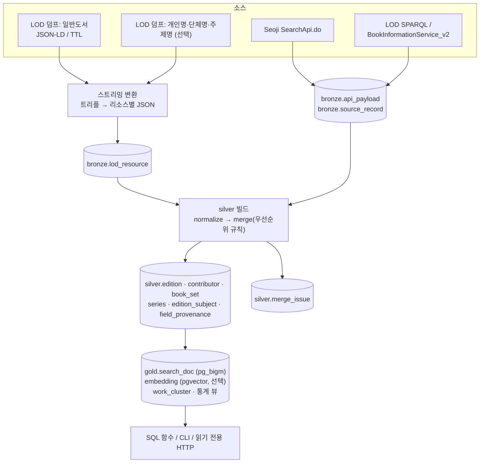

# Plan B: LOD 덤프로 시드 + Seoji 증분 (전체 국가서지 PostgreSQL)

> 작성일: 2026-10-22. 사실 관계의 근거는 `research_notes/한국 서지정보 API 조사/`다. 노트에 없는 수치(서버 사양, 기간, 비용, 호출 예산)는 **추정** 또는 **설계 선택**이라고 표시했다.

## 1. 목표와 범위

**목표**: 국립중앙도서관 국가서지 LOD 덤프로 과거 도서 전체를 한 번에 시드하고, Seoji API로 신간·근간·미납본 ISBN을 매일 반영한다. 이렇게 "한국 도서 전체" 수준의 정규화 DB를 PostgreSQL 한 대에 구축한다. 라이선스가 가장 명확한 경로(공공누리 1유형 + CC0)를 중심에 두고, 나중에 서비스(Plan C)나 분석(Plan D)의 기반이 되는 **원천 DB(source of truth)**로 쓴다.

**포함 범위**
- LOD **일반도서(전자책 포함)** 데이터셋: 3,980,216건, TTL 1,057.9 MB / JSON-LD 883.5 MB, 갱신일 2026-10-08 (nlk_apis.md Q1-8).
- (선택) 권위 데이터셋: 개인명 1,859,505건, 단체명 156,213건, 주제명(NLSH) 257,764건. 저자·주제를 URI로 연결하는 데 쓴다.
  - LOD 현황 페이지는 개인명과 단체명 수치가 서로 뒤바뀐 것처럼 보인다. 그래서 다운로드 페이지의 수치를 기준으로 삼는다.
- Seoji 전 기간을 날짜 윈도우로 수집한다. 미납본(`deposit_yn=N`)과 근간도 포함한다.
- bronze/silver/gold 3계층 파이프라인. 검색은 pg_bigm이 기본이고, pgvector는 선택이다.
- 읽기 전용 SQL 함수와 최소한의 조회 CLI 또는 HTTP 엔드포인트.

**제외**: 대출 통계(Plan D), 상업 API 보강과 공개 검색 서비스(Plan C), KORMARC 원본(기관만 신청 가능하고 개인은 제외), 표지 이미지 복제.

**완료 기준**
- LOD 일반도서를 모두 bronze에 적재한다. 리소스 수는 덤프 표기와 ±1% 안에서 일치해야 한다.
- ISBN이 있는 레코드는 모두 `silver.edition`에 들어간다.
- Seoji 일일 증분이 자동으로 돈다.
- 병합 규칙을 바꾼 뒤 API를 다시 호출하지 않고 bronze에서 silver를 전부 재생성할 수 있다.
- 제목·저자 부분 일치 검색(조사가 붙은 형태 포함)이 동작한다.

## 2. 사용할 API와 이유

| 소스 | 역할 | 이유 (근거) |
|---|---|---|
| **LOD 데이터셋 다운로드** (`lod.nl.go.kr/home/dataset/datadownload.do`) | 초기 시드, 정기 전체 갱신 | NLK가 제공하는 **유일한 실질적 대량 경로**다. 공공누리 1유형 + CC0이라 상업적 이용과 재배포가 가능하다. 다운로드 전에 간단한 폼(소속 유형, 기관명, 사용 목적)을 낸다. (Q1-8, Q4) |
| **Seoji** `nl.go.kr/seoji/SearchApi.do` | 신간·근간 증분, 거래 필드 | 날짜 범위 필터가 있는 유일한 API다. 가격, 부가기호, 세트 ISBN, 형태(FORM), 전자책 여부, 표지 URL, 납본 여부처럼 LOD에 없는 필드를 준다. LOD에는 가격과 표지 필드가 없다. (Q1-1, Q1-7) |
| **LOD SPARQL** `lod.nl.go.kr/sparql` | 검증, 덤프 사이 단건 보정 | 키가 필요 없다. 적재가 끝나면 COUNT를 대조한다. 2026-10-22 기준 `bibo:Book`은 3,644,964건이다. 타임아웃과 행 제한이 문서화되어 있지 않으므로 소량으로만 쓴다. |
| data.go.kr `BookInformationService_v2` (선택) | 덤프 사이 ISBN 단건 조회 대안 | LOD를 기반으로 실시간 갱신되고 필드가 약 150개다. 다만 날짜 필터가 없고 개발계정 트래픽이 10,000이다. 운영계정은 심의를 거쳐야 한다. SPARQL이 불안정할 때 쓰는 대체 경로다. |

### 사용하지 않는 API와 이유

| API | 이유 |
|---|---|
| KOLIS-NET MARC/목차 대량 제공 | 승인받은 기관만 신청할 수 있고 **개인은 대상이 아니다**. 영리적 이용을 제한하는 것이 목적이다. (Q1-9) |
| search.do / KOLIS-NET / seojiSearch.do | 결과를 500건까지만 볼 수 있다. 탐색용 API다. |
| data.go.kr 저자·주제 API | 같은 내용을 덤프로 받을 수 있어서 호출 쿼터를 쓸 이유가 없다. |
| 도서관 정보나루 | 약관 제12조①5에 따라 사전 승낙 없이 복제하거나 제3자에게 제공하면 제한 사유가 된다. 원천 DB에 섞으면 재배포 가능성이 오염된다. → Plan C/D에서 별도 계층으로 다룬다 |
| 국회도서관 | 공공누리 1유형이라 쓸 수는 있다. 하지만 학위논문·기사 중심이고 검색 카테고리에 ISBN이 없어서 매칭 비용이 크다. → Plan C |
| Kakao / Naver / 알라딘 | Kakao는 DB 복제에 사전 승낙이 필요하다. Naver는 종료됐다. 알라딘은 2026-10-30에 종료되고 약관이 저장을 금지한다. |
| KPIPA ONIX API | 위원회 심사를 거쳐야 하고, 출판사가 동의한 2021-09-29 이후 도서만 나온다. 약관이 "다른 정보와 혼합하지 않고 독립적으로 노출"을 요구하므로 병합 DB와 맞지 않는다. |

## 3. 데이터 흐름



## 4. 저장소 선택과 스키마

**PostgreSQL 한 대**에 bronze, silver, gold를 스키마로 나눠 둔다. 원본 JSONB, 정규화 테이블, 검색 인덱스, 벡터를 모두 한 시스템에서 다룰 수 있다(storage_processing.md §4).

**규모 추정**
- 정규화 행 400만 건 × 2~5 KB이면 8~20 GB다.
- bronze 원본은 그 3~5배까지 늘 수 있다.
- 서버 한 대로 충분하다.

**pg_bigm을 쓰는 이유**
- 사전 없이 2-gram GIN 인덱스로 조사가 붙은 형태("대한민국은")까지 찾는다.
- 기본 `tsvector('simple')`은 이 경우를 놓친다.

```sql
CREATE SCHEMA bronze; CREATE SCHEMA silver; CREATE SCHEMA gold;
CREATE EXTENSION pg_bigm; CREATE EXTENSION pg_trgm; CREATE EXTENSION vector;  -- vector는 선택

-- ── bronze ───────────────────────────────────────────
CREATE TABLE bronze.lod_dump (
  dump_id serial PRIMARY KEY, dataset text NOT NULL,      -- book|person|organization|subject
  format text NOT NULL, file_name text, file_sha256 text,
  dump_date date, downloaded_at timestamptz, resource_count int
);
CREATE TABLE bronze.lod_resource (
  resource_uri  text PRIMARY KEY,                -- 예: http://lod.nl.go.kr/resource/KJU201703899
  dataset       text NOT NULL,
  body          jsonb NOT NULL,                  -- {predicate: [values...]} 형태로 정규화
  body_sha256   bytea NOT NULL,
  first_dump_id int, last_dump_id int,
  deleted_at    timestamptz                      -- 다음 덤프에서 사라지면 tombstone
);
CREATE TABLE bronze.api_payload (
  id bigserial PRIMARY KEY, source text NOT NULL, endpoint text NOT NULL,
  request_params jsonb NOT NULL,                 -- 키 제거
  fetched_at timestamptz NOT NULL, http_status int,
  body jsonb NOT NULL, body_sha256 bytea NOT NULL,
  UNIQUE (source, body_sha256)
);
CREATE TABLE bronze.source_record (
  source text, source_key text, isbn13 char(13),
  payload_id bigint REFERENCES bronze.api_payload(id),
  record jsonb NOT NULL, record_sha256 bytea NOT NULL,
  first_seen_at timestamptz, last_seen_at timestamptz,
  PRIMARY KEY (source, source_key)
);
CREATE TABLE bronze.record_history (               -- 내용이 바뀌면 이전 버전 보관 (SCD2)
  source text, source_key text, record_sha256 bytea, record jsonb,
  valid_from timestamptz, valid_to timestamptz
);

-- ── silver ───────────────────────────────────────────
CREATE TABLE silver.publisher (
  id bigserial PRIMARY KEY, name text NOT NULL, name_normalized text NOT NULL,
  isbn_prefix text,                              -- 발행자번호 (RangeMessage.xml로 하이픈 분해)
  UNIQUE (name_normalized, isbn_prefix)
);
CREATE TABLE silver.edition (
  isbn13 char(13) PRIMARY KEY,
  isbn10 char(10),
  primary_resource_uri text,                     -- 대표 LOD 리소스 (없으면 NULL)
  work_id bigint,                                -- gold 클러스터링 결과 (nullable)
  title text NOT NULL, remainder_of_title text,
  title_normalized text NOT NULL, title_hanja text,
  volume_label text, edition_statement text, responsibility_stmt text,
  publisher_id bigint REFERENCES silver.publisher(id), publication_place text,
  pub_date date,
  pub_date_precision text CHECK (pub_date_precision IN ('day','month','year')),
  pub_status text CHECK (pub_status IN ('announced','published','unknown')),
  extent_raw text, page_count int, dimensions_raw text, height_cm numeric(5,1),
  width_mm int, height_mm int,
  binding text CHECK (binding IN ('paper','ebook','audio','mixed','other')),
  ea_add_code char(5),
  add_reader char(1), add_form char(1), add_kdc_class char(1), add_kdc_division char(2),
  kdc text, kdc_edition text, ddc text, nlk_call_no text,
  language text, original_title text, translation_of text,
  price_planned int, price_real int,
  cover_url text,                                -- Seoji TITLE_URL, 핫링크 전용
  deposit_yn boolean, cip_control_no text,
  redistributable boolean NOT NULL DEFAULT true, -- 제3자 저작물 필드는 별도 테이블로 분리
  provenance jsonb NOT NULL,                     -- {field: source} 요약
  content_hash bytea NOT NULL,
  first_seen_at timestamptz, last_seen_at timestamptz, updated_at timestamptz
);
CREATE TABLE silver.edition_record_link (        -- ISBN 1개 : 소스 레코드 N개
  isbn13 char(13) REFERENCES silver.edition, source text, source_key text,
  link_role text CHECK (link_role IN ('primary','secondary','conflict')),
  PRIMARY KEY (source, source_key, isbn13)
);
CREATE TABLE silver.manifestation_no_isbn (      -- ISBN 없는 LOD 레코드 (오래된 자료 등)
  resource_uri text PRIMARY KEY, title text, responsibility_stmt text,
  publisher text, issued_year int, kdc text, body_ref text
);
CREATE TABLE silver.contributor (
  id bigserial PRIMARY KEY, display_name text NOT NULL, name_normalized text NOT NULL,
  name_hanja text, birth_year int, death_year int,
  kac_uri text UNIQUE,                           -- LOD dcterms:creator 권위 URI
  isni text, external_ids jsonb
);
CREATE TABLE silver.edition_contributor (
  isbn13 char(13) REFERENCES silver.edition, ordinal int,
  contributor_id bigint REFERENCES silver.contributor(id),
  role text NOT NULL, role_raw text, source text NOT NULL,
  PRIMARY KEY (isbn13, ordinal)
);
CREATE TABLE silver.book_set (
  set_isbn13 char(13) PRIMARY KEY, set_add_code char(5), set_expression text,
  title text, total_volumes int, is_open_ended boolean
);
CREATE TABLE silver.set_member (
  set_isbn13 char(13) REFERENCES silver.book_set, isbn13 char(13) REFERENCES silver.edition,
  volume_label text, PRIMARY KEY (set_isbn13, isbn13)
);
CREATE TABLE silver.series (
  id bigserial PRIMARY KEY, title text NOT NULL, title_normalized text NOT NULL,
  publisher_id bigint, UNIQUE (title_normalized, publisher_id)
);
CREATE TABLE silver.edition_series (
  isbn13 char(13), series_id bigint, series_no text, source text,
  PRIMARY KEY (isbn13, series_id)
);
CREATE TABLE silver.subject_heading (            -- 주제명 덤프 (NLSH/KSH)
  uri text PRIMARY KEY, pref_label text, alt_labels text[], broader text[], narrower text[]
);
CREATE TABLE silver.edition_subject (
  isbn13 char(13), scheme text CHECK (scheme IN ('kdc','ddc','add_code','ksh','nlk_keyword','seoji_subject')),
  code text, label text, source text, PRIMARY KEY (isbn13, scheme, code, source)
);
CREATE TABLE silver.edition_rich_text (          -- 재배포 제한 필드 분리
  isbn13 char(13), kind text CHECK (kind IN ('toc','introduction','summary','abstract')),
  source text, body text, redistributable boolean NOT NULL,
  PRIMARY KEY (isbn13, kind, source)
);
CREATE TABLE silver.field_provenance (
  isbn13 char(13), field text, source text, source_key text,
  raw_value text, normalized_value text, chosen boolean NOT NULL, rule text,
  observed_at timestamptz, PRIMARY KEY (isbn13, field, source, source_key)
);
CREATE TABLE silver.merge_issue (
  id bigserial PRIMARY KEY, isbn13 char(13), kind text,  -- isbn_conflict|multi_lod|invalid_isbn|title_mismatch
  detail jsonb, created_at timestamptz DEFAULT now(), resolved_at timestamptz
);

-- ── gold ─────────────────────────────────────────────
CREATE TABLE gold.search_doc (
  isbn13 char(13) PRIMARY KEY, title text, authors text, publisher text, series text,
  kdc text, add_reader char(1), binding text, pub_year int,
  search_text text NOT NULL,                     -- 제목×2 + 저자 + 출판사 + 총서 + 주제
  embedding vector(1024), embedding_model text
);
CREATE INDEX search_doc_bigm ON gold.search_doc USING gin (search_text gin_bigm_ops);
CREATE INDEX search_doc_vec  ON gold.search_doc USING hnsw (embedding vector_cosine_ops)
  WITH (m = 16, ef_construction = 128);          -- 선택
CREATE TABLE gold.work_cluster (work_id bigint, isbn13 char(13) PRIMARY KEY, confidence real, method text);
```

**ISBN 없는 레코드 정책**: 국가서지에는 ISBN이 없는 오래된 자료도 들어 있을 수 있다. `edition`의 키는 ISBN-13이므로 이런 레코드는 `manifestation_no_isbn`에 따로 보관한다. 검색에 넣을지는 미해결 질문으로 남긴다.

## 5. 가공 단계

1. **LOD 덤프 변환**
   - TTL은 스트리밍 파서로 N-Triples로 바꾼다. Apache Jena `riot`이나 Oxigraph를 쓴다.
   - 주어(subject)를 기준으로 외부 정렬한 뒤, 리소스 하나를 JSON 문서 하나로 묶는다.
   - JSON-LD를 쓸 경우 구조를 다운로드 페이지의 샘플 파일로 먼저 확인한다.
   - blank node와 다중값 술어를 다루는 규칙을 M1에서 명세로 정한다.
2. **LOD 필드 매핑** (술어 URI는 샘플 파일로 확정한다; nlk_apis.md Q1-7/8)
   - `bibo:isbn` → isbn
   - `dcterms:title` / `rdfs:label` → title
   - `nlon:remainderOfTitle` → 부표제
   - `dc:creator` → 책임표시 문자열, `dcterms:creator` → KAC URI
   - `dc:publisher`, `nlon:publicationPlace`, `dcterms:issued` → 발행 사항
   - `bibframe:extent` → "263 p" / "20 cm"
   - `nlon:kdc`, `nlon:editionOfKDC`, `nlon:ddc`, `nlon:itemNumberOfNLK` → 분류·청구기호
   - `dcterms:subject` → KSH URI
   - `nlon:titleOfSeries`, `nlon:volumeOfSeries` → 총서
   - `bibo:translationOf`, `nlon:translatedAs` → 번역 관계
   - `owl:sameAs`, `dcterms:language` → 외부 링크·언어
   - `nlon:datePublished`는 데이터 발행일시다. 샘플 레코드에서 실제 목록 작성일보다 훨씬 늦은 값이 나왔으므로 **변경 감지에 쓰지 않는다**.
3. **ISBN 정규화·검증**: Plan A와 같다.
   - 숫자만 남기고, 10자리는 13자리로 바꾸고, 체크 숫자를 검증한다.
   - 한국 ISBN 판정은 `97889`/`97911` 접두로 한다. 실패한 값은 `merge_issue(kind='invalid_isbn')`로 보낸다.
   - LOD 리소스 하나에 ISBN이 여러 개면 각 ISBN에 대해 링크를 만든다.
   - Seoji의 `RELATED_ISBN`은 원문으로 보존한다.
4. **부가기호 해석**: Seoji `EA_ADD_CODE`와 `SET_ADD_CODE`만 대상이다(LOD 필드 목록에는 부가기호가 없다). 코드표는 Plan A §5-3과 같다. 결과는 `edition_subject(scheme='add_code')`와 `add_*` 컬럼에 넣는다.
5. **저자 파싱**
   - LOD `dc:creator` 문자열과 Seoji `AUTHOR` 문자열을 역할어 사전으로 분해한다(Plan A §5-4와 같은 규칙).
   - LOD `dcterms:creator`의 KAC URI가 있으면, 개인명·단체명 덤프의 `prefLabel`/`altLabel`과 이름을 맞춰 `contributor.kac_uri`를 채운다.
   - URI가 있는 기여자는 URI가 같아야만 같은 사람으로 본다. URI가 없으면 정규화된 이름과 출판사로 묶는 약한 동일성만 쓰고, 표시도 따로 한다.
6. **텍스트 정규화**
   - HTML 제거와 unescape를 적용하고, 저장은 NFC로 한다.
   - 비교 키는 NFKC → casefold → 공백·가운뎃점·괄호 통일 → 구두점 제거 순으로 만든다.
   - 한자는 `*_hanja` 컬럼으로 빼낸다.
   - 권차·판차 표지는 비교 키에서 뺀다.
7. **형태사항 파싱**
   - `"263 p"`, `"xii, 263 p."` → `page_count=263`.
   - `"20 cm"` → `height_cm`.
   - Seoji `BOOK_SIZE "183*235"` → `width_mm`/`height_mm`.
   - "2책"처럼 여러 권이면 `page_count`를 NULL로 두고 원문만 남긴다.
8. **병합 규칙**: 필드마다 우선순위를 둔다. 설정 테이블이나 YAML로 관리한다.

| 필드 | 1순위 | 2순위 | 3순위 | 비고 |
|---|---|---|---|---|
| title / 부표제 | LOD | Seoji TITLE | — | LOD는 목록 데이터이고, Seoji는 출판사가 낸 사전 정보다 |
| 기여자·역할 | LOD (KAC 연결) | Seoji AUTHOR 파싱 | — | |
| 출판사 | LOD `dc:publisher` | Seoji PUBLISHER | — | `publisher_id`는 ISBN 발행자번호 우선 |
| 발행일 | Seoji PUBLISH_PREDATE (단, `DEPOSIT_YN=Y`이고 LOD 발행연도와 일치할 때) | LOD `dcterms:issued` (연 단위 정밀도) | Seoji 예정일 (`pub_status=announced`) | 정밀도를 함께 저장 |
| 쪽수·크기 | LOD extent | Seoji PAGE/BOOK_SIZE | — | Seoji 값은 예정값일 수 있다 (Q3) |
| KDC | LOD `nlon:kdc` | Seoji KDC | (부가기호 3~4자리는 `add_code` 스킴으로만) | |
| 주제 | LOD KSH | Seoji SUBJECT | — | 둘 다 저장 (스킴이 다름) |
| 총서 | LOD titleOfSeries | Seoji SERIES_TITLE | — | |
| 가격 | Seoji REAL_PRICE | Seoji PRE_PRICE | — | LOD에는 가격이 없다 |
| 부가기호·세트·FORM·전자책 | Seoji만 | — | — | binding은 부가기호 2번째 자리=5로 보조 판정 |
| 표지 URL | Seoji TITLE_URL만 | — | — | 핫링크 |

   - **유효성 조건**: 빈 문자열이 아니고, 파싱할 수 있고, "0"이 아니고, 날짜가 범위 안에 있을 때만 후보로 인정한다. 조건을 통과하지 못하면 다음 순위로 넘어간다.
   - **충돌 감지**
     - 같은 ISBN인데 Seoji 출판사와 LOD 출판사가 다르고 제목 bigram 유사도도 낮으면 `merge_issue('isbn_conflict')`로 표시한다. 예: 9788936434267의 부산점자도서관 레코드.
     - ISBN 하나에 LOD 리소스가 여럿이면 대표 리소스를 다음 순서로 고른다. ① 점자·대체자료가 아닌 것 ② 출판사가 발행자번호와 일치하는 것 ③ 필드 채움 수가 많은 것. 나머지는 `secondary`로 연결한다.
   - **절대 하지 않는 것**: ISBN이 다른 레코드를 하나의 edition으로 합치지 않는다.
   - 모든 후보 값은 `field_provenance`에 기록한다. 규칙을 바꾸면 `silver rebuild`로 전체를 다시 계산한다.
9. **(선택) 저작 클러스터링** (gold)
   - 블로킹 키: 권차를 뺀 정규화 제목 + 첫 번째 저자.
   - 점수: 제목 bigram Jaccard와 `translationOf` 일치.
   - 임계값 이상이면 자동으로 묶고, 중간 구간은 검토 큐로 보낸다.

## 6. 수집 전략

**초기 적재**
1. LOD 일반도서 덤프를 받는다(폼 제출). 파일 sha256을 `bronze.lod_dump`에 기록한다.
2. 변환한 결과를 `COPY`로 `bronze.lod_resource`에 넣는다. 적재할 때는 인덱스를 끄고, 끝난 뒤 만든다.
3. 적재 결과를 검증한다.
   - 리소스 수를 덤프 표기(3,980,216)와 SPARQL COUNT(`bibo:Book` 3,644,964)와 대조한다.
   - 두 수치의 차이(전자책 등 타입 구분으로 보인다)는 PoC에서 설명할 수 있어야 한다.
4. Seoji 백필
   - 하루 윈도우로 수집한다. 종이책과 전자책을 나눈다.
   - 시작 연도는 M1 PoC에서 Seoji에 있는 가장 오래된 발행예정일을 찾아 정한다.
   - 호출 수는 연도마다 수천 건, 전체로는 수만~십수만 건으로 **추정**한다.
5. silver를 전체 빌드한 뒤 gold 인덱스를 만든다. GIN/HNSW 인덱스를 만드는 동안만 `maintenance_work_mem`을 올린다.

**증분**
- **Seoji 일일 수집**: `[오늘-30일, 오늘+90일]`
- **Seoji 주간 수집**: `[오늘-1년, 오늘-30일]`
- **Seoji 분기 수집**: 전 기간 재수집. `INPUT_DATE`를 필터로 쓸 수 없어서 늦게 등록된 레코드를 잡으려면 필요하다.
- **LOD 갱신 감지**
  - 주 1회 다운로드 페이지의 "데이터 갱신일"을 확인한다. 갱신 주기는 공개되어 있지 않고, 관측된 날짜는 2026-10-08 하나뿐이다.
  - 날짜가 바뀌면 덤프를 다시 받아 `body_sha256`으로 비교한다.
  - 내용이 바뀐 리소스는 이전 버전을 `record_history`에 보관한다. 사라진 리소스는 `deleted_at`으로 tombstone 처리한다.
  - 델타 파일이 없으므로 매번 전체를 비교한다.
- **덤프와 덤프 사이 보정**
  - Seoji에서 `DEPOSIT_YN`이 Y로 바뀐 ISBN은 SPARQL로 단건 조회한다. 설계 선택으로 VALUES 절 하나에 ISBN 50개를 넣는다.
  - SPARQL이 실패하면 `BookInformationService_v2`를 쓴다. 개발계정 10,000의 단위는 포털 표기를 확인해야 하므로 설계 선택으로 일 8,000 이하로 제한한다.
- **silver 증분**: 바뀐 `source_record`나 `lod_resource`에 연결된 ISBN만 다시 병합한다. 바뀐 행은 outbox 테이블에 남겨 gold를 부분 갱신한다.

**재시도·쿼터**
- Seoji 규칙은 Plan A §6과 같다: 초당 1요청, 10초 타임아웃, 013이면 페이지 크기 축소, 010/011/012면 중단.
- data.go.kr 게이트웨이 코드 22(일일 한도 초과)와 23(초당 한도 초과)이 오면 그날 작업은 멈추고 다음 날 다시 시작한다.
- 작업 큐는 Postgres의 `SELECT … FOR UPDATE SKIP LOCKED`로 만든다.

## 7. 라이선스·약관 준수 사항

- **LOD 덤프·SPARQL**
  - 라이선스는 "공공누리 제1유형 및 CC0 1.0"이다. 누구나 자유롭게 이용할 수 있고, 상업적 이용과 재배포도 가능하다.
  - CC0이므로 출처 표시 의무는 없지만 예의상 "국립중앙도서관 국가서지 LOD"를 표기한다.
  - 다운로드 폼의 사용 목적은 사실대로 적는다.
- **Seoji**
  - 명시적 약관이 없다. data.go.kr 미러에는 "이용허락범위 제한 없음"으로 되어 있다.
  - 사실 서지 필드(제목, 저자, 가격, 부가기호 등)는 출처를 표기하고 쓴다.
  - 표지 URL, 책소개, 서평, 목차는 제3자 저작물일 가능성이 있다(추론). 그래서 `edition_rich_text`에 `redistributable=false`로 분리하고, 표지는 URL 핫링크만 쓴다.
- **공개 덤프나 API로 재배포할 때**: `silver.edition`의 사실 필드, LOD 유래 권위 데이터, 주제만 내보낸다. `edition_rich_text`와 `cover_url`은 기본으로 뺀다.
- **정보나루와 상업 API는 이 계획의 DB에 섞지 않는다.** 그래야 원천 DB 전체의 재배포 가능성이 유지된다.

## 8. 기술 스택

| 영역 | 선택 | 비고 |
|---|---|---|
| DB | PostgreSQL 16+ (pg_bigm, pg_trgm, pgvector) | pg_bigm은 RDS/Aurora(12.9 이상)에서 지원된다. Supabase/Neon 지원 여부는 **미검증**이므로 Docker 자체 호스팅이나 RDS를 쓴다 |
| RDF 변환 | Apache Jena `riot` 또는 Oxigraph(pyoxigraph) + GNU sort | 스트리밍, 외부 정렬 |
| 중간 처리 | DuckDB (N-Triples → Parquet → 그룹핑, 선택) | 메모리를 적게 쓰는 집계 |
| 수집·가공 | Python 3.12+, httpx, psycopg 3 (`COPY`) | 정규화 모듈은 Plan A와 공유 |
| 마이그레이션 | dbmate 또는 Alembic | |
| 오케스트레이션 | cron/systemd timer + Makefile. 소스가 늘면 Dagster | bronze/silver/gold를 자산으로 볼 수 있다 |
| 임베딩 (선택) | 다국어 모델 (BGE-M3, multilingual-e5 등) | `embedding_model` 컬럼으로 재생성 관리 |
| 백업 | pg_dump 주간 + bronze 원본 파일은 객체 저장소에 | |

## 9. 단계별 마일스톤

> 1인 개발 기준 집중 작업일 **추정**이다.

| # | 작업 | 산출물 | 추정 |
|---|---|---|---|
| M0 | NLK Open API 키 신청(승인 대기), LOD 덤프와 샘플 다운로드 | 키, 샘플 | 대기 |
| M1 | LOD 샘플 분석: 술어 목록, 다중값, blank node, ISBN 표기, 점자·대체자료 판별 방법 | 매핑 명세서 | 2~3일 |
| M2 | 덤프 변환기(스트리밍)와 bronze 적재, 수량 검증 | `lod load` 명령, 검증 리포트 | 3~4일 |
| M3 | Seoji 클라이언트와 백필 러너. Plan A 코드를 재사용하고 PoC로 시작 연도와 한도를 확인 | `seoji harvest` | 2~3일 |
| M4 | 정규화 라이브러리(ISBN, 부가기호, 저자, 형태사항, 텍스트)와 테스트 | `normalize/` | 3일 |
| M5 | 병합 엔진: 우선순위 설정, 유효성 조건, `field_provenance`, `merge_issue`, `silver rebuild` | silver 계층 | 4~5일 |
| M6 | gold: `search_doc`과 pg_bigm, 검색 SQL 함수(`search_books(q, filters)`), CLI | 검색 | 2~3일 |
| M7 | 증분 스케줄, LOD 갱신 감지와 diff, tombstone, outbox | 운영 자동화 | 2~3일 |
| M8 | 데이터 품질 리포트: 필드 채움률, 충돌 건수, 소스별 커버리지 | 주간 리포트 | 1~2일 |
| M9 | (선택) 권위 데이터 연결(KAC/KSH), 임베딩 + RRF 하이브리드 검색, 저작 클러스터링 | gold 확장 | 4~6일 |

**합계: 핵심(M1~M8) 약 4~6주. 선택 항목을 넣으면 +1~1.5주.**

## 10. 리스크와 대응

| 리스크 | 대응 |
|---|---|
| 덤프 구조나 규모가 예상과 다름 (1 GB TTL, blank node) | M1에서 샘플로 명세를 먼저 확정하고, 스트리밍과 외부 정렬로 메모리 사용을 묶어 둔다 |
| 덤프 갱신 주기를 모르고 델타도 없음 | 매주 갱신일을 확인하고 해시로 전체 비교한다. 덤프 사이 기간은 Seoji와 SPARQL로 메운다 |
| `nlon:datePublished`를 믿을 수 없음 | 변경 감지에 쓰지 않는다. 해시 비교만 쓴다 |
| LOD(소장 자료)와 Seoji(ISBN 등록 자료)의 범위가 다름 | ISBN으로 합집합을 만들고, `primary_source`와 커버리지 리포트로 차이를 보이게 한다 |
| 같은 ISBN에 다른 기관 레코드나 대체자료가 붙음 | 대표 레코드 선정 규칙을 두고 `merge_issue`로 검토 큐를 운영한다 |
| 관리형 호스트에서 pg_bigm을 못 씀 | 자체 호스팅 Docker나 RDS를 쓴다. 최후에는 pg_trgm으로 대체한다(2글자 질의 품질이 떨어짐) |
| 병합 규칙 버그 | bronze를 보존하므로 `silver rebuild`로 재계산할 수 있다. 규칙 변경에 회귀 테스트를 붙인다 |
| Seoji 키 승인 지연이나 차단 | LOD만으로 M1~M2, M4~M6을 먼저 진행할 수 있다 |

## 11. 예상 비용·운영 부담

- **서버**: 4 vCPU / 16 GB RAM / SSD 200 GB 정도의 Postgres 한 대로 **추정**한다.
  - silver는 8~20 GB, bronze는 그 3~5배, 여기에 인덱스가 더해진다.
  - 소형 VPS나 관리형 DB의 소형 인스턴스 수준이다.
- **객체 저장소**: 원본 덤프 파일을 보관한다(일반도서 기준 약 1 GB/회). R2는 송신 요금이 없어서 보관용으로 적합하다(노트, 현재 요금은 미확인).
- **임베딩(선택)**: 400만 건을 처음 생성하는 데 드는 비용은 모델 선택에 달려 있다. 자체 호스팅하면 GPU 시간이 든다.
- **운영 부담: 중간.**
  - 주간: 실패 확인, 품질 리포트 확인
  - 덤프 갱신 시: 재적재와 diff 점검
  - 분기: Seoji 전체 재수집
  - 연간: PG 업그레이드

## 12. 미해결 질문

1. ISBN 없는 국가서지 레코드(`manifestation_no_isbn`)를 검색과 서비스에 넣을까?
2. 일반도서 외에 오프라인자료(7,151,860건), 공공간행물(652,951건) 등으로 넓힐까? 데이터셋끼리 겹치는 범위는 PoC로 확인해야 한다.
3. 권위 데이터(개인명·단체명·주제명) 연결을 1차 범위에 넣을까?
4. 임베딩 기반 의미 검색이 필요할까? 필요하다면 외부 API를 쓸까, 자체 호스팅을 할까?
5. DB를 자체 호스팅할까, 관리형을 쓸까? pg_bigm 지원 여부가 기준이다.
6. 사실 필드만 담은 공개 덤프(예: 월간 Parquet)를 배포할 의향이 있을까?
