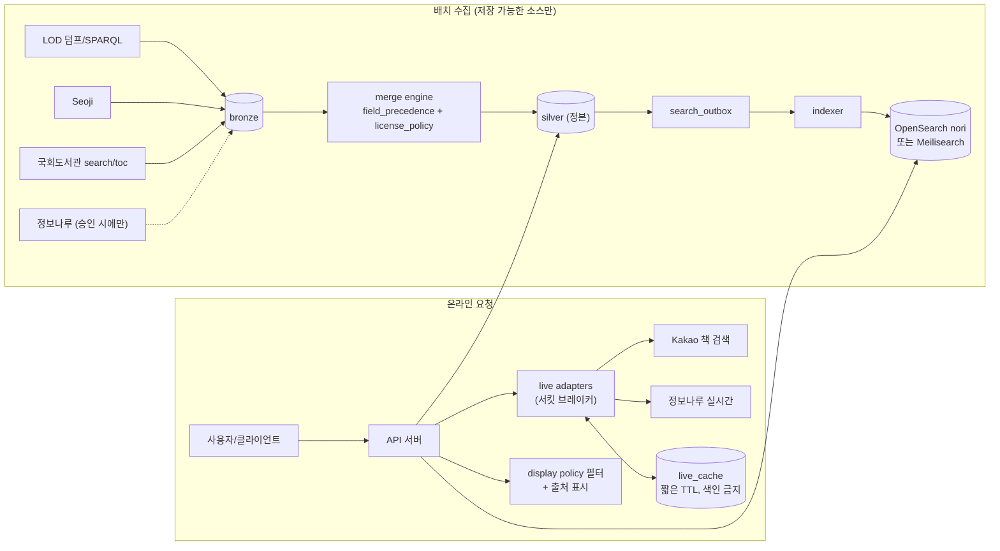

# Plan C: 다중 소스 병합 + 검색 서비스 (NLK + 정보나루 + 국회도서관 + Kakao 실시간)

> 작성일: 2026-10-22. 사실의 근거는 `research_notes/한국 서지정보 API 조사/` 노트다. 노트에 없는 수치(서버 사양, 캐시 TTL, 호출 예산 배분, 기간, 비용)는 **설계 선택** 또는 **추정**이라고 표시했다.

## 1. 목표와 범위

**목표**: 외부에 공개하거나 팀 내부에서 쓰는 **한국 도서 검색 서비스**를 만든다. 웹과 HTTP API로 제공한다. Plan B의 원천 DB(LOD + Seoji, PostgreSQL)를 정본으로 두고, 그 위에 세 가지 소스를 더한다.
- 정보나루: 대출 인기, 소장 도서관, 대출 가능 여부, 키워드
- 국회도서관: 목차, 청구기호
- Kakao: 표지 썸네일, 판매가, 소개. **표시할 때만 실시간으로 가져온다.**

소스마다 **약관상 허용 범위**가 다르다. 그래서 필드 단위 provenance와 라이선스 정책 계층을 두고, 각 필드를 저장할지, 색인할지, 표시할지, 재배포할지를 따로 통제한다. 검색 엔진은 OpenSearch(nori) 또는 Meilisearch를 쓴다.

**전제**: 이 계획은 Plan B의 M1~M7을 1단계로 포함한다. 아래에서 "B 계층"이라고 부른다.

**포함 범위**
- B 계층(LOD 시드와 Seoji 증분, bronze/silver/gold)
- 소스 레지스트리와 라이선스 정책 테이블
- 필드 우선순위 병합 엔진
- 정보나루, 국회도서관, Kakao 어댑터
- 검색 인덱스 동기화(outbox)
- API 서버와 최소한의 웹 UI
- 출처 표시

**제외**
- KPIPA ONIX: 위원회 심사가 필요하고, 다른 정보와 섞지 말고 독립적으로 노출하라는 조건이 있다.
- RISS: BY-NC-ND
- 사용자 계정과 개인화
- 표지 이미지 저장

**완료 기준**
- `/v1/search`와 `/v1/books/{isbn13}`가 p95 300ms 안에 응답한다(설계 목표).
- 모든 응답에 필드 출처와 소스 표시가 들어간다.
- 정책상 저장할 수 없는 소스의 데이터는 DB와 검색 인덱스 어디에도 없다. 감사 쿼리로 확인한다.
- 외부 소스 하나가 장애를 내도 핵심 검색은 계속 동작한다.

## 2. 사용할 API와 이유

| 소스 | 역할 | 저장 | 검색 색인 | 재배포 | 근거와 비고 |
|---|---|---|---|---|---|
| **LOD 덤프/SPARQL** | 기본 서지, 권위 데이터, KDC, KSH | O | O | O | 공공누리 1 + CC0 (nlk_apis.md Q4) |
| **Seoji** | 신간·근간, 가격, 부가기호, 세트, 표지 URL | O | O (사실 필드) | 사실 필드만 | 명시적 약관은 없고 data.go.kr에는 "제한 없음". 책소개·표지는 제3자 저작물일 가능성이 있다 |
| **국회도서관** (data.go.kr `9720000/searchservice`, `detailinfoservice/toc`) | 목차(toc), 청구기호, 학위논문 연계 | O | O | O (출처 표시) | 공공누리 1유형(출처 표시). 개발계정은 하루 약 10,000건, 운영계정은 최대 100,000건. 응답은 XML name/value 쌍이다. 검색 카테고리에 **ISBN이 없어서** 매칭 PoC가 필요하다 (other_public_apis.md C) |
| **도서관 정보나루** | 인기대출(`loanItemSrch`), 소장 도서관(`libSrchByBook`), 대출 가능(`bookExist`), 키워드(`keywordList`), 이용 분석(`usageAnalysisList`) | **승인 전: X** (실시간 + 단기 UX 캐시) / 승인 후: O | X | X | 약관 제12조①5와 제11조③이 사전 승낙 없는 복제와 제3자 제공을 제한한다. IP를 등록하면 하루 30,000건이다. `bookImageURL`은 **비영리 서비스의 화면 표시에만** 쓸 수 있고 복사, 저장, 재배포, AI 입력·학습은 금지다 (other_public_apis.md A) |
| **Kakao 책 검색** | 상세 페이지의 표지 썸네일, 정가·판매가, 소개, 판매 상태 | **X** (UX 캐시만, 최신 유지) | **X** | X | 운영정책: UX 개선 목적이 아닌 캐시는 금지되고, 캐시는 최신으로 유지해야 한다. 사전 승낙 없이 복사·복제하거나 "검색 엔진 또는 디렉터리에 입력"하는 것도 금지다. 책 검색은 하루 30,000건, 질의 하나당 최대 2,500건 (commercial_apis.md Q1, Q2) |

### 사용하지 않는 API와 이유

| API | 이유 |
|---|---|
| Naver 책 검색 | 2026-07-31 종료. API HUB로 이전되지도 않았다 |
| 알라딘 Open API | 2026-10-30 종료. 신규 키 발급은 2026-09-04에 끝났다. 약관이 저장(캐시 포함)을 금지하고, 법인이 도서 판매나 도서 정보 사업에 쓰는 것도 막는다 |
| KPIPA 출판유통통합전산망 | 위원회 심사가 필요하고 키는 1년마다 갱신해야 한다. "다른 정보와 혼합하지 않고 독립적으로 노출"하라는 조건(제8조⑤)이 병합 서비스와 정면으로 충돌한다. 별도 탭으로 노출하는 방식은 승인 후에 다시 검토한다 |
| RISS 단행본 | BY-NC-ND이고 기관 대상이다. 영리 목적이나 파생 저작에 쓸 수 없다 |
| 정보나루 openDataL 월간 덤프 | 데이터셋마다 승인을 받아야 하고 재배포 조건이 불명확하다. 서비스보다 분석에 맞으므로 Plan D로 보낸다 |
| Google Books / Open Library | Google Books는 익명 호출 쿼터가 0이다(관측). Open Library는 번역판을 work 하나로 묶어서 한국판 edition 데이터로 쓰기 어렵다 |

## 3. 데이터 흐름과 아키텍처



**핵심 원칙**
1. **저장 경로와 실시간 경로를 물리적으로 나눈다.** Kakao 데이터와 미승인 정보나루 데이터는 `live_cache`에만 짧게 머문다. silver와 검색 인덱스로 가는 길이 코드 수준에서 없어야 한다.
2. **정본은 Postgres 하나다.** 검색 엔진은 언제든 다시 만들 수 있는 파생물이다.

## 4. 저장소 선택과 스키마

- **PostgreSQL (정본)**: Plan B의 bronze/silver/gold 스키마(`silver.edition`, `edition_contributor`, `book_set`, `set_member`, `series`, `edition_subject`, `edition_rich_text`, `field_provenance`, `merge_issue`)를 그대로 쓴다.
  - edition은 ISBN-13을 키로 하고, 부가기호를 분해한 컬럼(`add_reader`/`add_form`/`add_kdc_class`/`add_kdc_division`)을 가진다.
  - contributor는 KAC URI와 역할을 담는다.
  - 세트와 총서는 별도 테이블이다.
- **검색 엔진**: 파생 인덱스다.
- **캐시**: Postgres 테이블이 기본이고 Redis는 선택이다. 실시간 소스용이다.

아래는 Plan B에 **추가**하는 테이블이다.

```sql
CREATE SCHEMA meta; CREATE SCHEMA ext; CREATE SCHEMA live;

-- 소스 레지스트리 + 라이선스 정책 (코드가 아니라 데이터로 관리)
CREATE TABLE meta.source (
  source text PRIMARY KEY,                 -- lod|seoji|nanet|data4library|kakao|llm:<model>
  license text NOT NULL,                   -- 'KOGL-1+CC0', 'none-stated(data.go.kr 제한없음)', 'KOGL-1', 'ToS', ...
  storable boolean NOT NULL,               -- silver 저장 허용
  indexable boolean NOT NULL,              -- 검색 인덱스 투입 허용
  redistributable boolean NOT NULL,        -- 덤프/API 재제공 허용
  commercial_ok boolean,                   -- NULL = 미확인
  attribution_text text NOT NULL,
  consent_status text CHECK (consent_status IN ('not_needed','pending','granted','denied')),
  consent_ref text,                        -- 승인 문서/메일 식별자
  daily_budget int, reviewed_at date
);

-- 필드별 우선순위 (설정 데이터)
CREATE TABLE meta.field_precedence (
  field text, source text REFERENCES meta.source, rank int,
  validity_rule text,                      -- 'non_empty', 'valid_date', 'int>0', 'len>=20' ...
  PRIMARY KEY (field, source)
);

-- 필드별 표시 정책 (license_class별 노출 허용 여부)
ALTER TABLE silver.field_provenance ADD COLUMN license_class text;   -- open|attribution|restricted

-- 국회도서관 매칭
CREATE TABLE ext.nanet_link (
  isbn13 char(13) REFERENCES silver.edition, nanet_control_no text,
  match_method text,                       -- isbn_in_record|title_author_year
  confidence real, matched_at timestamptz,
  PRIMARY KEY (isbn13, nanet_control_no)
);

-- 정보나루 저장 데이터 (consent_status='granted'일 때만 쓰기 허용 — 트리거로 강제)
CREATE TABLE ext.loan_popularity (
  isbn13 char(13), period_start date, period_end date,
  segment jsonb,                           -- {age, gender, region}
  ranking int, loan_count int, fetched_at timestamptz,
  PRIMARY KEY (isbn13, period_start, period_end, segment)
);

-- 실시간 소스 UX 캐시 (Kakao/정보나루). silver·검색 인덱스와 조인 금지.
CREATE TABLE live.cache (
  source text, cache_key text,             -- 예: kakao:isbn:9788936434267
  body jsonb NOT NULL, fetched_at timestamptz NOT NULL, expires_at timestamptz NOT NULL,
  PRIMARY KEY (source, cache_key)
);
CREATE INDEX ON live.cache (expires_at);   -- 만료 행 주기 삭제 잡

-- 보강 작업 큐 (저장 가능한 소스만)
CREATE TABLE ext.enrich_job (
  isbn13 char(13), source text REFERENCES meta.source,
  status text, attempts int DEFAULT 0, next_attempt_at timestamptz, last_error text,
  PRIMARY KEY (isbn13, source)
);

-- 검색 동기화 outbox
CREATE TABLE gold.search_outbox (
  id bigserial PRIMARY KEY, isbn13 char(13), op text CHECK (op IN ('upsert','delete')),
  created_at timestamptz DEFAULT now(), processed_at timestamptz
);

-- 저작 병합/분할 시 옛 ID가 계속 풀리도록
CREATE TABLE gold.work_redirect (old_work_id bigint PRIMARY KEY, new_work_id bigint, at timestamptz);
```

**검색 문서 매핑** (OpenSearch 기준). `indexable=true`인 소스의 필드만 넣는다.

| 필드 | 타입/분석기 | 출처 |
|---|---|---|
| `isbn13`, `isbn10`, `set_isbn13` | keyword | silver |
| `title`, `remainder_of_title` | text: `nori` 형태소 분석(색인은 `decompound_mode: mixed`) + `ngram` 서브필드 + `edge_ngram` 자동완성 | LOD/Seoji |
| `authors[]` (이름, 역할) | nested: text + keyword | LOD/Seoji |
| `publisher`, `series` | text + keyword | LOD/Seoji |
| `kdc`, `kdc_class`, `add_reader`, `add_form`, `binding`, `pub_year` | keyword/int (패싯) | silver |
| `subjects[]` | keyword + text | LOD KSH |
| `toc` | text (nori) | 국회도서관 (open) / Seoji 목차는 **넣지 않는다** (restricted) |

- nori `user_dictionary_rules`에는 작가명, 시리즈명, 신조어를 넣는다. 초기 사전은 contributor 표시명 상위 빈도에서 뽑는다.
- Meilisearch를 고르면 같은 필드에 `filterableAttributes`와 `sortableAttributes`를 지정한다. Meilisearch의 한국어 분석은 lindera ko-dic이다.

## 5. 가공 단계

Plan B §5의 1~9단계(ISBN 정규화·검증, 부가기호 해석, 저자 파싱, HTML 제거와 NFC 정규화, 형태사항 파싱, 병합)를 그대로 따른다. 여기에 다음을 추가한다.

1. **국회도서관 레코드 처리**
   - `record/item`의 name/value 쌍을 dict로 바꾼다. 같은 name이 반복되면 배열로 묶는다.
   - 레코드 안에 ISBN 값이 있으면 정규화해서 바로 매칭한다(`isbn_in_record`).
     - **응답에 ISBN 항목이 있는지는 노트로 확인되지 않았다.** M2 PoC의 첫 번째 확인 항목이다.
   - ISBN이 없으면 `자료명,제목 | 저자,첫저자`로 검색한다. 발행자와 연도가 일치하고 제목 bigram 유사도가 0.9 이상(설계 선택)이면 링크를 만든다. 그보다 낮은 후보는 버린다.
   - `toc` 응답은 HTML 제거와 NFC 정규화를 거쳐 `edition_rich_text(kind='toc', source='nanet', redistributable=true)`에 넣는다.
2. **정보나루 값 처리** (실시간 또는 승인 후 저장)
   - `isbn13`이 10자리일 수 있으니 13자리로 바꾼다. `set_isbn13`과 `vol`은 세트를 구분하는 데 쓴다.
   - `addition_symbol`은 정보나루 코드표에 따라 해석한다. 정보나루 코드표에는 2=여성이 있는데 NLK 현행 안내에는 2가 미배정이다. 이 불일치를 기록한다.
   - `class_no`는 `edition_subject(scheme='kdc', source='data4library')`에 후보로만 넣는다(승인 후). NLK KDC와의 품질 비교 자료가 없으므로 우선순위는 LOD와 Seoji 다음이다.
3. **Kakao 응답 처리** (실시간 전용)
   - `isbn` 필드는 "ISBN10 ISBN13"처럼 공백으로 나뉘어 올 수 있다. 13자리를 우선한다.
   - 978/979가 아닌 13자리 코드는 버린다.
   - HTML 태그를 제거한다.
   - `status` 문자열로 로직을 분기하지 않는다. 문서가 값이 바뀔 수 있다고 밝히고 있어서 표시용으로만 쓴다.
   - 결과는 `live.cache`에만 두고 **silver 병합 후보로 쓰지 않는다.** `translators` 배열도 마찬가지로 저장용 역할 분해에 쓰지 않는다.
4. **병합 우선순위 확장**: `meta.field_precedence`의 기본값은 아래와 같다.

| 필드 | 1 | 2 | 3 | 4 |
|---|---|---|---|---|
| title, 기여자, 출판사, 쪽수·크기 | LOD | Seoji | 국회도서관 | — |
| KDC | LOD | Seoji | 정보나루(승인 시) | 부가기호(`add_code` 스킴) |
| 목차 | 국회도서관 (open) | Seoji 목차 (restricted: 표시 정책 적용) | — | — |
| 가격 | Seoji REAL_PRICE | Seoji PRE_PRICE | (Kakao는 실시간 표시만) | — |
| 표지 | Seoji TITLE_URL 핫링크 | (Kakao `thumbnail`은 실시간 표시만) | — | — |
| LLM 추정값 (장르 태그 등, 선택) | 원천 필드가 없을 때만 | `source='llm:<model>'`, confidence 저장 | — | — |

5. **표시 정책 필터**
   - API가 응답을 만들 때 각 필드의 `license_class`와 `meta.source` 정책을 검사한다.
   - 요청 컨텍스트에는 `commercial`(서비스가 상업적인지 여부, 배포 설정)이 들어간다.
   - 예: 정보나루 `bookImageURL`은 서비스가 상업적이면 응답에서 뺀다.
   - 모든 응답에 `sources: [{source, attribution_text}]`를 붙인다.

## 6. 수집 전략

**배치 (저장 가능한 소스)**
- **B 계층**: Plan B §6과 같다. LOD 시드, Seoji 일일·주간·분기 수집, LOD 갱신 diff.
- **국회도서관**
  - 목차가 없는 edition부터 `ext.enrich_job`에 넣는다.
  - 개발계정 기간에는 하루 9,000건으로 제한한다(설계 선택, 한도는 약 10,000건/일).
  - 운영계정 심의를 통과하면 최대 100,000건/일 안에서 늘린다.
  - 신간을 먼저 처리하고, 이어서 정보나루 인기 도서(실시간 조회 로그 기반), 마지막으로 나머지 순서로 한다.
  - 오류 22(일일 한도)가 나면 그날은 멈춘다. 30/31(미등록·만료 키)과 32(미등록 IP)는 즉시 알린다.
- **정보나루 (승인 후에만)**: `loanItemSrch`로 월별 인기대출 스냅샷을 받아 `ext.loan_popularity`에 넣는다. 질의당 최대 5,000건이다.

**실시간 (저장 불가 소스)**
- **Kakao**
  - 상세 페이지 요청이 들어올 때 `target=isbn`으로 조회한다.
  - `live.cache` TTL은 24시간이다(설계 선택). 노트가 요구하는 "UX 개선 목적, 최신 유지" 조건을 맞추기 위한 값이다.
  - 하루 30,000건 쿼터에 맞춰 28,000건에서 자체 차단한다(설계 선택). 쿼터를 넘기는 것은 정책 위반이고, 앱을 여러 개 만들어 쿼터를 늘리는 것도 금지다.
  - **스윕하지 않는다.** 출판사명을 돌려 가며 열거하는 것 같은 방식은 쓰지 않는다.
- **정보나루 실시간**
  - 소장 도서관(`libSrchByBook`), 대출 가능(`bookExist`), 키워드를 조회한다. 캐시 TTL은 6~24시간이다(설계 선택). `loanAvailable`은 전날 기준 값이다.
  - 하루 30,000건 가운데 실시간에 70%, 승인 후 배치에 30%를 쓴다(설계 선택). 28,500건에서 차단한다. 같은 방식을 쓰는 오픈소스 사례가 있다(other_public_apis.md A).
  - **고정 IP 서버가 필요하다.** 하루 500건을 넘기려면 서버 IP를 등록해야 하므로, GitHub Actions처럼 IP가 바뀌는 러너에서는 돌릴 수 없다.
  - 문서는 `http://`만 안내한다. https가 되는지 먼저 확인하고, 키는 서버에만 둔다.
- **서킷 브레이커**: 외부 소스가 연속으로 실패하거나 응답이 느리면 해당 블록을 빼고 응답한다. 핵심 서지는 silver에서 오므로 계속 제공된다.

**검색 동기화**
- silver가 바뀌면 같은 트랜잭션에서 `search_outbox`에 기록한다. indexer는 이를 bulk로 반영한다.
- 매주 전체 재색인을 하고 alias로 전환한다(blue/green).
- 정본과 인덱스의 건수와 해시 샘플을 비교해 어긋남을 감지한다.

## 7. 라이선스·약관 준수 사항

| 항목 | 조치 |
|---|---|
| 출처 표시 | 서비스 하단과 `/about/sources` 페이지, 그리고 API 응답 `sources`에 출처를 표기한다. 대상: "국립중앙도서관 국가서지 LOD", "국립중앙도서관 ISBN 서지정보유통지원시스템", "국회도서관(공공누리 제1유형)", "도서관 정보나루", "Daum 책 검색". Kakao의 BI나 표시 의무는 노트에서 확인하지 못했으므로 문의 항목에 넣는다 |
| 정보나루 | M0에서 NLK(libdata@korea.kr)에 이용 목적을 밝히고 **저장과 서비스 제공에 대한 사전 승낙**을 요청한다. 승인 전에는 실시간 조회와 단기 캐시만 쓰고, 저장·재배포·AI 입력은 하지 않는다. 표지(`bookImageURL`)는 비영리 서비스의 화면 표시에만 쓰고, 상업 서비스면 끈다 |
| Kakao | 영구 저장, 검색 인덱스 투입, 재판매, "판매 연결"(구매 제휴 링크 등)을 하지 않는다. 직원 답변에 따르면 광고가 붙은 무료 앱은 별도 제한이 없지만, 저장 관련 질문에는 답이 없었다. DB 보강까지 하려면 Kakao의 사전 승낙을 받아야 한다 |
| 국회도서관 | 공공누리 1유형이다. 출처를 표시하면 상업적 이용과 변경이 가능하다. 운영 단계는 심의를 거쳐야 한다 |
| Seoji 제3자 콘텐츠 | 책소개, 서평, 목차, 표지는 `restricted`로 분류한다. 표시하더라도 재배포하는 API·덤프에서는 뺀다(보수적 추론) |
| AI 사용 | 정보나루 데이터로 임베딩을 만들거나 LLM 입력에 쓰지 않는다. 표지 이미지는 명시적으로 금지되어 있고, 그 밖의 데이터도 복제 제한이 있다. 임베딩은 LOD와 Seoji 사실 필드로만 만든다 |
| 감사 | 매주 쿼리를 돌려 `meta.source.storable=false`인 소스의 값이 silver, ext, 검색 인덱스에 없는지 확인한다 |

## 8. 기술 스택

| 영역 | 선택 | 대안 |
|---|---|---|
| 정본 DB | PostgreSQL 16+ (pg_bigm, pgvector) | — |
| 검색 | **OpenSearch + analysis-nori**: 형태소 분석, 사용자 사전, 패싯, 하이라이트, BM25 | **Meilisearch**: 운영이 쉽고 오타 허용과 lindera ko-dic을 지원하지만 한국어 튜닝 폭이 좁다. 트래픽이 작으면 Plan B의 pg_bigm만으로 시작한다 |
| API | Python FastAPI + pydantic (OpenAPI 문서 자동 생성) | TypeScript (Hono/Fastify) |
| 워커 | Python. Postgres 큐(`SKIP LOCKED`)와 cron. 소스가 늘면 Dagster | Prefect |
| 캐시 | Postgres `live.cache` | Redis |
| 웹 UI (최소) | Astro 또는 Next.js. 검색, 상세, 출처 페이지 | — |
| 배포 | Docker Compose, **고정 IP VPS** | 관리형 DB + 컨테이너 호스팅(고정 아웃바운드 IP 필요) |
| 관측 | 구조화 로그, 소스별 호출 수와 쿼터 대시보드, 실패율 알림 | Prometheus/Grafana |

nori 플러그인은 모든 노드에 설치하고 재시작해야 한다. OpenSearch 배포판에 nori가 기본으로 들어 있는지는 **확인하지 못했다**(storage_processing.md Gaps). M5에서 먼저 확인한다.

## 9. 단계별 마일스톤

> 1인 개발 기준 집중 작업일 **추정**이다. 외부 승인을 기다리는 기간은 뺐다.

| # | 작업 | 산출물 | 추정 |
|---|---|---|---|
| M0 | 승인과 계정: NLK 키, data.go.kr(국회도서관) 개발계정, 정보나루 키와 IP 등록, **정보나루 사전 승낙 요청**, Kakao 앱 등록과 저장 문의 | 신청 기록, `meta.source` 초기값 | 대기 (병렬 진행) |
| M1 | B 계층 구축 (Plan B M1~M7) | 정본 DB | 4~5주 |
| M2 | 국회도서관 PoC: 응답에 ISBN 항목이 있는지, 매칭률, 목차 커버리지 | PoC 리포트, 진행 여부 결정 | 2~3일 |
| M3 | 소스 레지스트리, `field_precedence`, `license_class`, 표시 정책 필터, 감사 쿼리 | 정책 계층 | 3일 |
| M4 | 국회도서관 어댑터와 보강 큐, 목차 병합 | ext 계층 | 3~4일 |
| M5 | 검색 엔진 구축: 매핑, nori 사전, outbox indexer, alias 재색인 | 검색 인덱스 | 5~7일 |
| M6 | API 서버: `/v1/search`, `/v1/books/{isbn13}`, `/v1/sets/{set_isbn13}`, `/v1/series/{id}`, `/v1/contributors/{id}`, `/v1/books/{isbn13}/libraries?region=`, `/v1/books/{isbn13}/live` | API + OpenAPI 문서 | 5~6일 |
| M7 | 실시간 어댑터(Kakao, 정보나루), `live.cache`, 쿼터 가드, 서킷 브레이커 | 실시간 블록 | 3~4일 |
| M8 | 최소 웹 UI와 출처 페이지 | 웹 | 4~5일 |
| M9 | 부하 테스트, 배포, 모니터링, 백업, 장애 대응 문서 | 운영 준비 | 3~4일 |
| M10 | (승인 시) 정보나루 저장형 인기도, 패싯과 정렬에 반영 | 확장 | 2~3일 |

**합계: 약 10~14주** (B 계층 포함).

## 10. 리스크와 대응

| 리스크 | 영향 | 대응 |
|---|---|---|
| 정보나루 승낙이 거절되거나 지연됨 | 인기 정렬이나 저장형 통계를 쓸 수 없다 | 실시간 기능만 제공한다(소장 도서관, 대출 가능). 정렬은 신간과 관련도로 대신한다 |
| Kakao 약관 해석이 모호함 | 실시간 표시조차 문제가 될 가능성 | 표시는 UX 캐시 범위로 제한하고, 문의 결과에 따라 기능 플래그로 끈다. 표지는 Seoji URL로 대체한다(대부분 비어 있다는 한계가 있다) |
| 국회도서관 ISBN 매칭률이 낮음 | 목차 보강 효과가 작다 | M2 PoC 결과로 진행 여부를 정한다. 매칭률이 낮으면 M4를 뺀다 |
| 검색 엔진 운영 부담(JVM, 업그레이드) | 운영 비용 증가 | Meilisearch나 pg_bigm으로 바꿀 수 있게 검색 어댑터 인터페이스를 둔다 |
| 정본과 인덱스가 어긋남 | 검색 결과 불일치 | outbox, 주간 전체 재색인, 건수와 해시 대조 |
| 쿼터 소진(정보나루 30,000, Kakao 30,000) | 실시간 블록이 빠진다 | 자체 차단 임계값, 캐시 적중률 모니터링, 부드러운 기능 저하 |
| 공개 서비스의 법적 리스크(표지, 소개 텍스트) | 게시 중단 요청 | `restricted` 필드는 기본으로 끄고, 신고 접수 창구와 빠른 비활성화 플래그를 둔다 |
| 정보나루 문서가 http만 안내함 | 키 노출 | 서버에서만 호출한다. https가 되면 전환한다 |

## 11. 예상 비용·운영 부담

- **서버**: 고정 IP VPS 1~2대로 **추정**한다.
  - Postgres(4 vCPU/16 GB)와 OpenSearch(힙 4~8 GB)를 함께 두려면 8 vCPU/32 GB급 한 대이거나, 두 대로 나눈다.
  - Meilisearch를 고르면 요구 사양이 낮아진다.
- **외부 API**: 쓰는 소스는 모두 무료 쿼터 안에서 쓴다. Kakao 쿼터를 늘리려면 Daum 제휴 경로로 문의해야 한다(유료 정책은 미확인).
- **도메인과 TLS**, 백업용 객체 저장소.
- **운영 부담: 높음.**
  - 수시: 외부 승인과 약관 변경 추적, 쿼터 모니터링
  - 주간: 재색인과 감사 쿼리
  - 상시: 장애 대응. 공개 서비스라 사용자 영향이 생긴다

## 12. 미해결 질문

1. 서비스를 공개할까, 팀 내부용으로 둘까? 상업적으로 운영할까(광고, 유료 API)? 정보나루 표지와 Kakao 정책 적용이 여기에 따라 달라진다.
2. 정보나루 사전 승낙을 요청할 의향이 있을까? 대출 인기 기능이 꼭 필요할까?
3. Kakao 실시간 표시(표지, 판매가)가 꼭 필요할까? 없어도 되면 약관 리스크를 아예 없앨 수 있다.
4. 검색 엔진은 OpenSearch, Meilisearch, pg_bigm 중 무엇으로 할까? 예상 트래픽과 운영 역량이 기준이다.
5. 웹 UI까지 만들까, API만 만들까?
6. 고정 IP 서버(VPS)를 쓸 수 있을까?
7. 재배포 API(사실 필드 전용 공개 API나 덤프)를 제공할까?
