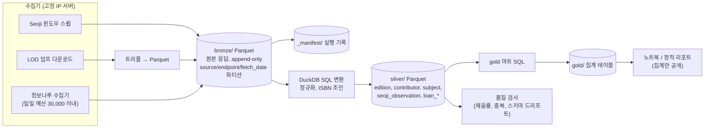

# Plan D: 분석·데이터레이크형 (원본 Parquet 아카이브 + DuckDB + 대출 트렌드)

> 작성일: 2026-10-22. 사실 근거는 `research_notes/한국 서지정보 API 조사/` 노트다. 노트에 없는 수치(호출 예산 배분, 기간, 비용)는 **설계 선택** 또는 **추정**이라고 표시했다.

## 1. 목표와 범위

**목표**: 서비스가 아니라 **분석**을 위한 계획이다. 수집한 원본 응답을 하나도 버리지 않고 시점별 스냅샷으로 Parquet 아카이브에 쌓는다. 그 위에서 DuckDB로 두 가지 질문에 답한다.
- 어떤 책이 언제, 얼마에, 어떤 분야로 나오는가 (출판 트렌드)
- 그 책이 도서관에서 어떻게 읽히는가 (대출 트렌드)

결과물은 노트북, 정적 리포트, 집계 CSV다.

**분석 질문 예시** (1차 범위에서 고른다)
- 월별 신간 수: KDC 주류, 부가기호 독자대상(아동·청소년·학습), 전자책 비율, 세트 비율
- 출판사별 발행량과 집중도
- 정가 추이: KDC별 중앙값, 예정가와 실제 정가의 차이(PRE_PRICE vs REAL_PRICE)
- 예정일과 실제 납본 사이의 시차: 같은 ISBN을 여러 번 스냅샷한 Seoji 데이터로 계산
- 번역서 비율: LOD `bibo:translationOf`/`nlon:translatedAs`
- 인기대출 순위의 시계열: 연령, 성별, 지역별
- 출간 후 대출 곡선: `usageAnalysisList`의 12개월 월별 대출 이력
- 월간 키워드(`monthlyKeywords`), 지역별 독서량과 독서율(`readQt`)

**포함**
- Seoji 스냅샷
- LOD 덤프 스냅샷
- 정보나루 통계 엔드포인트
- 레이크 레이아웃, 실행 manifest, 데이터 품질 검사
- 집계 마트와 리포트

**제외**: 실시간 검색 서비스, 상업 API, 표지 이미지, 원자료를 재배포하는 공개 산출물.

**완료 기준**
- bronze가 append-only로 쌓이고, 모든 파일은 실행 manifest로 추적된다.
- silver와 gold는 SQL 파일만으로 bronze에서 결정적으로 다시 만들 수 있다.
- 분석 질문 3개 이상에 대한 리포트를 낸다.

## 2. 사용할 API와 이유

| 소스 | 엔드포인트 | 분석에서의 역할 | 근거 |
|---|---|---|---|
| **Seoji** | `SearchApi.do` 날짜 윈도우 | 출판 트렌드의 모집단(신간·근간). 매번 다시 수집하므로 스냅샷이 쌓이고, 예정일·가격 변경 이력과 납본 전환 시점을 분석할 수 있다 | 날짜 필터가 있는 유일한 API. INPUT_DATE/UPDATE_DATE/DEPOSIT_YN을 준다 (nlk_apis.md Q2) |
| **LOD 덤프** | 일반도서 등 데이터셋 다운로드 | 과거 출판 기준선: KDC, 번역 관계, 형태사항 | 공공누리 1 + CC0. 일반도서 3,980,216건 |
| **도서관 정보나루** | `loanItemSrch` | 기간과 세그먼트(성별, 연령, 지역, KDC, 부가기호)별 인기대출. 질의당 최대 5,000건 | other_public_apis.md A #3 |
| | `usageAnalysisList` | ISBN별 최근 12개월 월별 대출, 연령·성별 대출 그룹, 키워드, 함께 대출된 책 | #8 |
| | `hotTrend` | 대출 급상승 (3일, 일별 상위 5) | #12 |
| | `monthlyKeywords` | 월간 TF-IDF 키워드 100개 | #17 |
| | `readQt` | 지역·연령별 독서량과 독서율 (2016년부터 작년까지) | #18 |
| | `loanItemSrchByLib` (선택) | 도서관·지역별 인기대출 (최대 200건) | #9 |
| | openDataL 월간 장서/대출 데이터 (선택) | 도서관 1,678곳의 장서와 대출 원자료. 데이터셋마다 이용 신청과 승인이 필요하다 | other_public_apis.md A, Q3 |

### 사용하지 않는 API와 이유

| API | 이유 |
|---|---|
| Kakao / Naver / 알라딘 | Kakao는 DB 저장에 사전 승낙이 필요하다. Naver는 종료됐다. 알라딘은 2026-10-30에 종료되고 저장을 금지한다. 판매 순위 계열 데이터는 상업 API로 더 이상 구할 수 없다 (commercial_apis.md Q3) |
| KPIPA 판매·정가변경 통계 | 사이트에 페이지는 있지만 API로 열려 있는지 알 수 없다. 키도 위원회 심사를 거쳐야 한다 |
| 국회도서관 / RISS | 논문과 대학 소장 데이터라 출판·대출 트렌드 분석과 거리가 멀다. RISS는 BY-NC-ND다 |
| data.go.kr `BookInformationService_v2` | 덤프와 내용이 겹치고 날짜 필터가 없다 |
| 정보나루 `bookImageURL` | 비영리 화면 표시에만 쓸 수 있다. **저장과 AI 입력·학습이 금지**되어 있으므로 수집하는 단계에서 이 필드를 지운다 |

## 3. 데이터 흐름



## 4. 저장소 선택과 스키마

**Parquet(zstd)과 DuckDB를 쓴다.**
- DuckDB는 JSON, CSV, Parquet을 직접 읽을 수 있어서 bronze에서 silver를 다시 계산하기 좋다.
- 컬럼형 압축으로 공간을 줄인다(storage_processing.md §4).
- OLTP 저장소는 두지 않는다.
- 레이크는 로컬 디스크나 S3 호환 객체 저장소(R2 등)에 둔다.

```
lake/
  bronze/source=seoji/endpoint=SearchApi/fetch_date=2026-10-22/run=<run_id>/part-0.parquet
  bronze/source=lod/dataset=book/dump_date=2026-10-08/part-*.parquet        # 트리플 테이블
  bronze/source=data4library/endpoint=loanItemSrch/fetch_date=.../part-0.parquet
  silver/edition/snapshot=2026-10-22/…    silver/edition_contributor/…  silver/book_set/…
  silver/series/…  silver/edition_subject/…  silver/seoji_observation/…
  silver/loan_rank/…  silver/loan_monthly/…  silver/loan_group/…  silver/keyword_monthly/…  silver/read_rate/…
  gold/new_titles_monthly/…  gold/price_index_kdc/…  gold/loan_curve/…  gold/rank_timeseries/…
  _manifest/runs.parquet
catalog.duckdb   # Parquet 글롭 위의 VIEW 정의만 담는다 (데이터는 없음)
```

**bronze 공통 컬럼** (API 응답 하나가 한 행)

| 컬럼 | 타입 | 설명 |
|---|---|---|
| `run_id` | VARCHAR | 수집 실행 ID |
| `source`, `endpoint` | VARCHAR | |
| `request_params` | JSON | **인증키 제거** |
| `fetched_at` | TIMESTAMP | |
| `http_status` | INT | |
| `body` | VARCHAR (JSON 원문) | 스키마가 바뀌어도 손실이 없도록 문자열로 둔다. 정보나루 `bookImageURL`은 수집 시점에 지운다 |
| `body_sha256` | VARCHAR | 같은 요청의 해시가 직전과 같으면 행을 생략하고 manifest에만 기록 |

**bronze LOD 트리플**: `resource_uri, predicate, object, object_type(uri|literal|bnode), datatype, lang, dump_date`

**silver 테이블** (컬럼 목록)

- **`edition`** (스냅샷 파티션; 키 `isbn13`)
  - 식별자: `isbn13`(CHAR 13), `isbn10`
  - 서지: `title`, `title_normalized`, `volume_label`, `edition_statement`, `responsibility_stmt`, `publisher`, `publisher_normalized`
  - 발행: `pub_date`, `pub_date_precision`, `pub_status`
  - 형태: `page_count`, `width_mm`, `height_mm`, `binding`, `is_ebook`
  - 부가기호: `ea_add_code`, `add_reader`, `add_form`, `add_kdc_class`, `add_kdc_division`
  - 분류: `kdc`, `ddc`
  - 가격: `price_planned`, `price_real`
  - 기타: `deposit_yn`, `original_title`, `translation_of`
  - 출처: `provenance`(MAP<VARCHAR,VARCHAR>: 필드→소스), `content_hash`
- **`edition_contributor`**: `isbn13`, `ordinal`, `name`, `name_normalized`, `name_hanja`, `role`, `role_raw`, `kac_uri`, `source`
- **`book_set`** / **`set_member`**: `set_isbn13`, `set_add_code`, `set_expression`, `total_volumes` / `set_isbn13`, `isbn13`, `volume_label`
- **`series`**: `isbn13`, `series_title`, `series_title_normalized`, `series_no`, `source`
- **`edition_subject`**: `isbn13`, `scheme`(kdc|ddc|add_code|ksh|seoji_subject|data4library_kdc), `code`, `label`, `source`
- **`seoji_observation`** (시계열; 스냅샷마다 한 행): `isbn13`, `observed_at`, `run_id`, `publish_predate`, `price_planned`, `price_real`, `deposit_yn`, `input_date`, `update_date`, `record_sha256`
- **`loan_rank`**: `period_start`, `period_end`, `age`, `gender`, `region`, `dtl_region`, `kdc`, `add_code`, `ranking`, `isbn13`, `loan_count`, `fetched_at`, `run_id`
- **`loan_monthly`**: `isbn13`, `month`, `loan_cnt`, `ranking`, `fetched_at`
  - `usageAnalysisList`는 최근 12개월만 주므로 **같은 월이 여러 번 관측된다.** 분석할 때는 가장 마지막에 관측한 값을 쓴다.
- **`loan_group`**: `isbn13`, `age`, `gender`, `loan_cnt`, `ranking`, `window`(30일), `fetched_at`
- **`keyword_monthly`**: `month`, `word`, `weight`
- **`read_rate`**: `year`, `month`, `region`, `dtl_region`, `age`, `quantity`, `rate`
- **`isbn_quarantine`**: `raw_isbn`, `source`, `reason`, `run_id`

**provenance**: silver의 모든 행에 `source`와 `run_id`(또는 `provenance` 맵)가 붙는다. `run_id`로 bronze 파일 경로까지 되짚어 갈 수 있다.

## 5. 가공 단계

변환은 모두 **DuckDB SQL 파일**(`transforms/silver/*.sql`)로 만든다. 정규식으로 처리하기 어려운 부분만 Python UDF로 둔다.

1. **JSON 분해**
   - Seoji는 `body → docs[]`, 정보나루는 `response → docs/doc` 같은 구조를 `json_extract`와 `unnest`로 행으로 펼친다.
   - 엔드포인트마다 구조가 다르므로 매핑 SQL을 엔드포인트별로 한 파일씩 둔다.
2. **ISBN 정규화·검증**
   - Plan A §5-2와 같다: 숫자만 남기고, 10자리는 13자리로 바꾸고, mod-10/mod-11로 검증하고, 97889/97911이면 한국 ISBN으로 판정한다.
   - 정보나루는 10자리와 13자리가 섞여 있어서 조인하기 전에 반드시 13자리로 맞춘다.
   - 검증에 실패하면 `isbn_quarantine`으로 보낸다.
3. **부가기호 해석**
   - 대상은 Seoji `EA_ADD_CODE`와 정보나루 `addition_symbol`이다.
   - 코드표 차이를 기록한다. 독자대상 2는 정보나루에서 "여성", NLK 현행 안내에서 미배정이다.
   - 세그먼트 분석에는 `add_reader`를 쓰고, 형태(전자책=5, 그림책·만화=7, 전집·시리즈=4)에는 `add_form`을 쓴다.
4. **저자 문자열 파싱**
   - Seoji `AUTHOR`, 정보나루 `authors`, LOD `dc:creator`를 역할어 사전으로 분해한다(Plan A §5-4).
   - 출판사별, 저자별 집계에는 `name_normalized`를 쓴다.
5. **HTML 제거와 NFC 정규화**
   - 텍스트를 NFC로 바꾸고, 집계 키는 NFKC + casefold로 만든다.
   - 출판사명은 공백과 "(주)", "㈜" 표기를 통일한다. NFKC가 ㈜를 접는다.
   - 출판사 집계에서는 ISBN 발행자번호를 이름보다 우선하는 키로 쓴다.
6. **병합·중복 제거 규칙**
   - edition 스냅샷은 Plan B §5-8의 우선순위 표를 따른다(LOD 목록 필드 > Seoji, 가격·부가기호·세트는 Seoji).
   - 분석용이라 병합하기 전 관측치도 `seoji_observation`에 모두 남긴다.
   - 순위 데이터는 `(period, segment, ranking)`을 키로, 같은 키를 다시 수집하면 최신 `fetched_at`으로 덮어쓴다.
7. **비교 가능성 보정**
   - 정보나루는 참여 도서관이 시점마다 다르다. `hotTrend`는 기준일 참여 도서관만 반영하고, 공개를 중단한 도서관도 있다.
   - 그래서 시계열을 비교할 때는 참여 도서관 수(`libSrch`로 수집)로 정규화한 지표를 같이 낸다.
   - Seoji `PUBLISH_PREDATE`는 예정일이므로 "출간 통계"는 `deposit_yn=Y`인 것과 전체를 나눠서 보고한다.
8. **품질 검사** (SQL assert)
   - 필드 채움률(예: PAGE, TITLE_URL)
   - ISBN 체크섬 실패율
   - 스냅샷 사이 건수 급변
   - 스키마 드리프트: 처음 보는 JSON 키를 감지

## 6. 수집 전략

**Seoji**
- 일일 수집 `[오늘-30일, 오늘+90일]`, 주간 수집 `[오늘-1년, 오늘-30일]`, 분기 전체 백필. 윈도우 단위, 초당 1요청, 재시도 규칙은 Plan A §6과 같다.
- 응답 해시가 같아도 manifest에는 "관측됨"을 기록한다. 그래야 `seoji_observation`의 관측 간격을 알 수 있다.

**LOD**
- 갱신일이 바뀌면 덤프 전체를 새 `dump_date` 파티션에 넣는다. 덤프끼리는 해시로 비교해 변경 리소스를 분석한다.

**정보나루 예산** (IP 등록 시 하루 30,000건, 28,500건에서 차단. 아래 배분은 설계 선택)

| 작업 | 주기 | 하루 호출 수 (추정) | 비고 |
|---|---|---|---|
| `hotTrend` | 매일 | 1 | |
| `loanItemSrch` 월간 스냅샷 | 매월 1일 이후 며칠에 걸쳐 | 세그먼트 수 × 페이지 수 (페이지 200건, 최대 5,000건이면 25페이지) | 세그먼트는 연령·성별·지역 조합 중 분석에 필요한 것만 고른다. `startDt`와 `endDt`를 항상 둘 다 지정한다(`endDt`만 주면 시작일이 2014-01-01로 잡힌다) |
| `loanItemSrch` 과거 백필 | 최초 1회, 여러 날에 나눠서 | 남은 예산 | 2014년부터 조회할 수 있는 것으로 **추정**한다(`endDt`만 주면 2014-01-01부터라는 규칙에서 추론). PoC로 확인한다 |
| `usageAnalysisList` | 연속 | ~20,000 | 우선순위: ① 순위에 오른 ISBN ② 최근 6개월 신간 표본 ③ 나머지. 12개월 창이라 **매월 다시 관측해야 긴 시계열이 생긴다** |
| `monthlyKeywords` | 매월 | 1 | 지난달까지만 조회할 수 있다 |
| `readQt` | 연 1회와 월별 | 소량 | |
| `libSrch` (참여 도서관 수) | 매월 | 소량 | 정규화용 |

- **고정 IP가 필요하다.** IP를 등록하지 않으면 하루 약 500건으로 제한된다. GitHub Actions처럼 IP가 바뀌는 러너는 쓸 수 없으므로 소형 VPS나 집 서버(고정 IP)에서 돌린다.
- **재시도**: 타임아웃과 5xx는 지수 백오프로 최대 5회 재시도한다. 일일 한도에 걸리면 다음 날 이어서 한다. 남은 작업은 `_manifest/queue.parquet` 또는 SQLite 작업 큐로 관리한다.
- **openDataL 월간 덤프** (선택): 필요한 도서관만 이용 신청한다. 파일 형식과 컬럼은 아직 확인하지 못했다. 승인되면 `bronze/source=data4library_dump/`에 원본 그대로 보관한다.

## 7. 라이선스·약관 준수 사항

- **정보나루가 핵심 리스크다.**
  - 이용약관 제12조①5는 "서비스를 통해 얻은 정보를 도서관의 사전 승낙 없이 서비스 이용 외의 목적으로 복제"하거나 제3자에게 제공하는 것을 제한 사유로 든다.
  - 정보나루는 스스로를 "사서, 연구자, 민간사업자"의 분석을 지원하는 플랫폼이라고 소개한다. 하지만 원자료를 장기간 보관하는 것이 "서비스 이용"에 해당하는지는 명시되어 있지 않다.
  - 그래서 **M0에서 NLK(libdata@korea.kr)에 분석·연구 목적과 보관 방식을 밝히고 승낙을 요청한다.**
  - 승낙 전에는 아래를 지킨다.
    - 레이크는 비공개로 두고 접근을 본인으로 한정한다.
    - 원자료(순위 목록, ISBN별 대출 이력)는 공개하지 않는다.
    - 공개 산출물은 **집계 통계와 해석**으로 한정한다. 예: KDC별 월간 대출 지수. 원 순위표를 재현할 수 있는 수준의 표는 내지 않는다.
- **표지 이미지**: `bookImageURL`은 수집 단계에서 지운다. 저장과 AI 입력·학습이 금지되어 있기 때문이다.
- **AI 사용**: 정보나루 데이터를 LLM 학습이나 임베딩에 쓰지 않는다.
- **Seoji**: 사실 필드 분석에는 문제가 없다. 출처는 "국립중앙도서관"으로 표기한다. 책소개·서평 텍스트는 분석 대상에서 뺀다(제3자 저작물일 가능성).
- **LOD**: CC0이라 제약이 없다. 덤프에서 파생한 집계는 자유롭게 공개할 수 있다.
- **리포트 출처 표기**: "자료: 국립중앙도서관 국가서지 LOD, ISBN 서지정보유통지원시스템, 도서관 정보나루(국립중앙도서관)".

## 8. 기술 스택

| 영역 | 선택 | 비고 |
|---|---|---|
| 저장 | Parquet (zstd), 로컬 디스크 또는 R2/S3 | R2는 송신 요금이 없다는 노트가 있다(현재 요금은 미확인) |
| 쿼리 | DuckDB (CLI + Python) | `httpfs`로 객체 저장소를 직접 읽는다 |
| 수집 | Python 3.12+, httpx, pyarrow (Parquet writer) | Seoji 클라이언트는 Plan A와 공유 |
| RDF | Apache Jena `riot` 또는 Oxigraph로 N-Triples 변환 → 파서로 트리플 Parquet 생성 | N-Triples를 CSV로 읽는 방식은 리터럴 이스케이프 때문에 쓰지 않음 |
| 변환 관리 | SQL 파일과 Makefile. 규모가 커지면 dbt-duckdb 또는 SQLMesh | 의존 순서와 테스트 |
| 분석 | Jupyter 또는 marimo, Polars (선택) | |
| 리포트 | 정적 사이트(Evidence, Quarto 등) | 집계만 포함 |
| 스케줄 | 고정 IP 서버의 cron/systemd timer | 정보나루 IP 등록용 |
| 정리 | 월간 compaction | 작은 파일이 쌓이는 문제 |

## 9. 단계별 마일스톤

> 1인 개발 기준 집중 작업일 **추정**이다. 승인을 기다리는 기간은 뺐다.

| # | 작업 | 산출물 | 추정 |
|---|---|---|---|
| M0 | NLK 키 신청. 정보나루 키 발급과 서버 IP 등록. **정보나루에 분석 목적 보관 승낙 요청**. 분석 질문 상위 3개 확정 | 신청 기록, 질문 목록 | 대기 |
| M1 | 레이크 레이아웃, Parquet writer(해시 생략, manifest), 키 제거 | `lake/` 라이브러리 | 2일 |
| M2 | Seoji 수집기를 bronze에 연결하고 백필 시작 (Plan A 코드 재사용) | Seoji bronze | 2~3일 |
| M3 | LOD 덤프를 트리플 Parquet으로 변환 | LOD bronze | 2~3일 |
| M4 | 정보나루 수집기: 예산 관리기, 엔드포인트 6종, 순위 백필 PoC | 정보나루 bronze | 4~5일 |
| M5 | silver 변환 SQL (정규화 UDF 포함)과 품질 검사 | silver | 4~5일 |
| M6 | gold 마트 3~5개와 첫 분석 노트북 | 분석 결과 | 3~4일 |
| M7 | 스케줄링, compaction, 백업(객체 저장소 동기화), 실패 알림 | 운영 | 1~2일 |
| M8 | 공개 리포트(집계만), 출처 표기 | 정적 리포트 | 2~3일 |

**합계: 약 3.5~5주.**

## 10. 리스크와 대응

| 리스크 | 대응 |
|---|---|
| 정보나루 보관 승낙을 못 받음 | 레이크는 비공개 분석용으로만 쓰고, 공개는 집계로 한정한다. 승낙이 끝내 거절되면 원자료 보관을 멈추고 수집하면서 바로 집계하는 방식으로 바꾼다 |
| 하루 30,000건 한도 | 우선순위 큐를 쓰고, 세그먼트를 최소한으로 고르고, 백필을 장기간에 걸쳐 나눈다 |
| `usageAnalysisList`가 12개월 창 | 매월 다시 관측해서 긴 시계열을 쌓는다. 과거 이력은 복원할 수 없다는 한계를 문서화한다 |
| 참여 도서관이 바뀌어 지표 왜곡 | 참여 도서관 수로 정규화하고, 기준 도서관 패널(계속 참여한 도서관)을 별도 지표로 둔다 |
| Seoji 예정값 편향 | `deposit_yn`과 관측 시점으로 나누고, 예정에서 확정으로 바뀐 이력을 분석 대상으로 삼는다 |
| LOD `datePublished`가 재발행 시점일 가능성 | 변경 감지는 해시로 하고, 이 값을 "목록 일자"로 쓰지 않는다 |
| 작은 Parquet 파일 폭증 | 일 단위로 파티션하고 월간 compaction을 돌린다 |
| JSON 스키마 드리프트 | bronze는 원문 문자열로 보관하고, 처음 보는 키를 감지하면 알린다 |
| 정보나루 문서가 http만 안내함 | 서버에서만 호출한다. https가 되는지 확인한다 |

## 11. 예상 비용·운영 부담

- **저장**: Seoji 스냅샷은 해시가 같으면 생략하고, LOD 덤프는 갱신할 때마다 약 1 GB급 원본과 Parquet 변환본이 생긴다. 정보나루 응답까지 합쳐 **수십 GB 이내로 추정**한다. 로컬 디스크나 저가 객체 저장소면 된다.
- **컴퓨팅**: 수집기 하나와 DuckDB. 고정 IP 소형 VPS 한 대면 충분하다(추정). 분석은 로컬 노트북에서 한다.
- **운영 부담: 낮음~중간.**
  - 수시: 예산 소진과 실패 확인
  - 월간: 스냅샷 수집 확인과 compaction
  - 덤프 갱신 시: 재적재
  - 서비스 장애라는 개념이 없다

## 12. 미해결 질문

1. 1차 분석 질문 상위 3개는 무엇일까? 질문에 따라 정보나루 세그먼트와 예산 배분이 달라진다.
2. 분석 결과를 공개할까(블로그, 리포트)? 공개한다면 어느 수준의 집계까지 낼까?
3. 정보나루 보관 승낙을 요청할 의향이 있을까? openDataL 도서관별 월간 덤프까지 신청할까?
4. 고정 IP로 쓸 수 있는 서버가 있을까?
5. 분석 기간은 얼마로 할까? 정보나루 순위를 2014년부터 백필할지는 PoC 결과를 보고 정한다.
6. 나중에 서비스(Plan B/C)와 레이크를 함께 쓸 계획이 있을까? 있다면 bronze를 서비스 DB와 공유하는 구조를 미리 정해야 한다.
